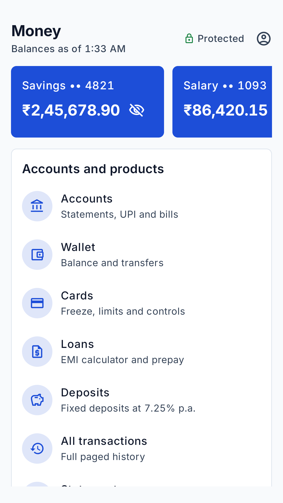
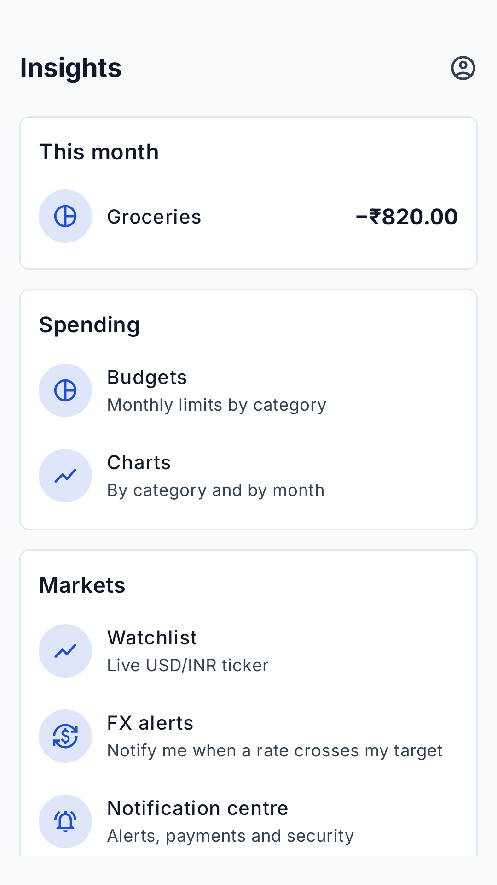
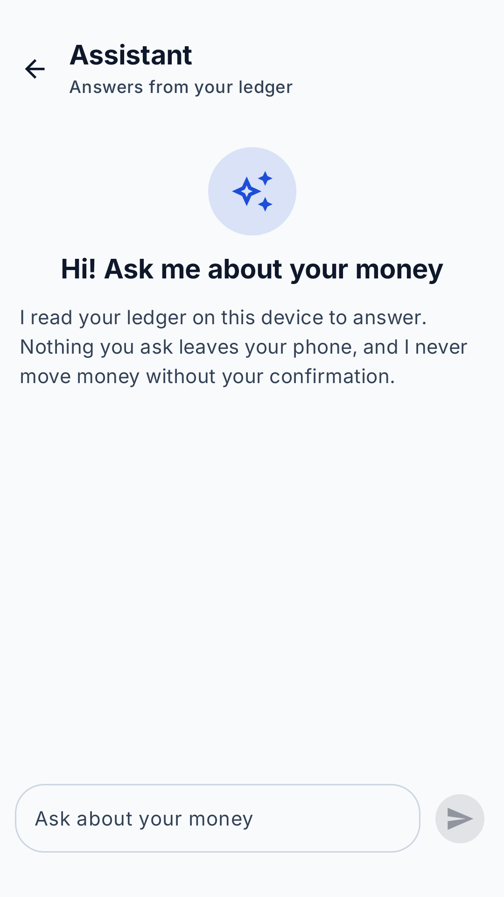
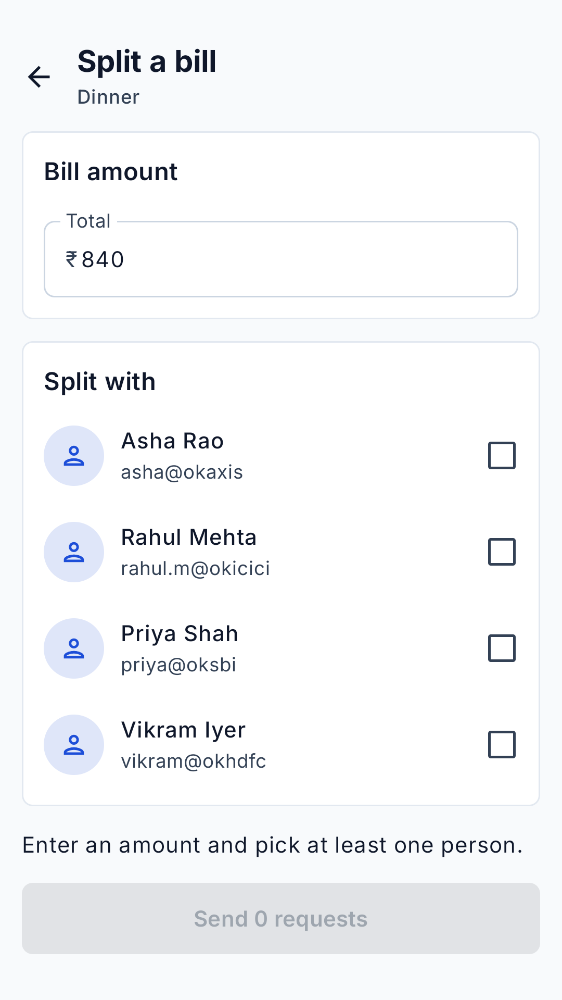
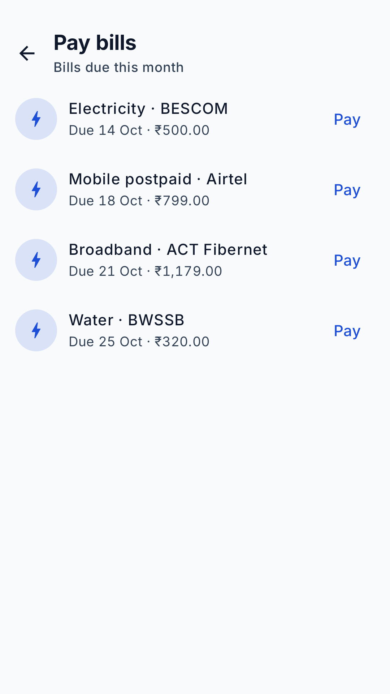
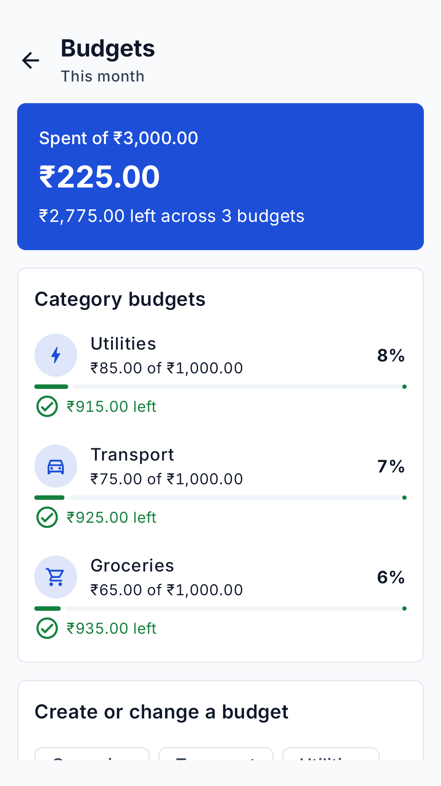
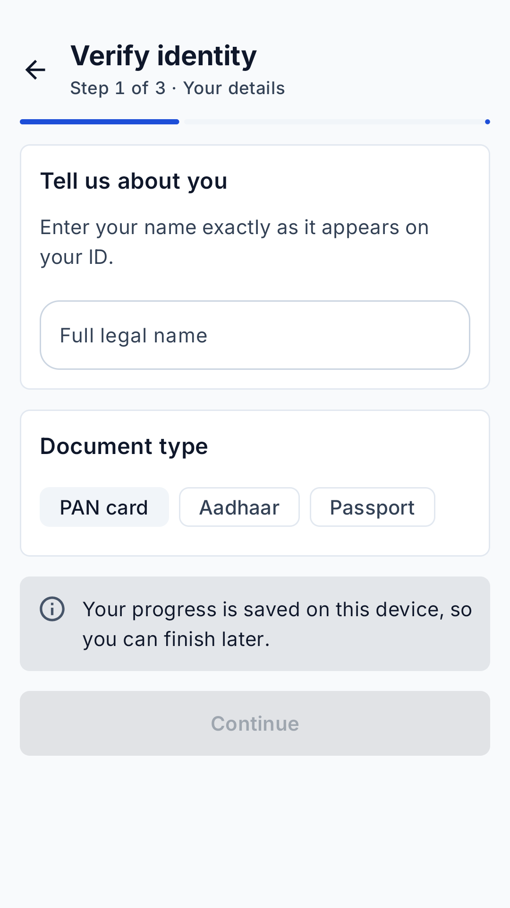

# LedgerOne (Personal Ledger)

LedgerOne is an Android banking and personal-finance app. It tracks your transactions, sends and requests money by UPI, manages cards, loans and deposits, pays bills, and keeps working offline.

It is written in Kotlin with Jetpack Compose, Hilt, Room, WorkManager and Ktor.

By default the app runs fully offline on built-in demo data, so you can clone it and run it without a backend.

## Quick start

Requirements: Android Studio (recent), JDK 17, an emulator or phone on Android 8.0 (API 26) or later.

```bash
git clone <this repo>
cd "Personal ledger"
./gradlew :app:installMockDebug
```

Or open the folder in Android Studio, pick the `mockDebug` build variant, and press Run.

In the mock build:

- the sign-up code is `123456`;
- you choose your own 4-digit MPIN during onboarding, and `1111` also unlocks this build;
- Profile → **Mock controls** lets you simulate a slow network, server errors, going offline, empty data, or a sync conflict.

## Build variants

One flavor dimension, `environment`. Debug and release stay build types: debug logs HTTP and adds `.debug` to the application id; release is minified and does not.

| Variant | Application id | API | Data |
|---------|----------------|-----|------|
| `mockDebug` (default) | `com.ledger.personal.mock.debug` | `http://10.0.2.2:8080/retail/v1/` | In-app mock backend |
| `devDebug` / `devRelease` | `com.ledger.personal.dev` (plus `.debug` on debug) | `https://dev-api.personal-ledger.com/retail/v1/` | Real API |
| `stagingDebug` / `stagingRelease` | `com.ledger.personal.staging` (plus `.debug` on debug) | `https://staging-api.personal-ledger.com/retail/v1/` | Real API |
| `prodDebug` / `prodRelease` | `com.ledger.personal` (plus `.debug` on debug) | `https://api.personal-ledger.com/retail/v1/` | Real API |

`mock` is the only flavor on the mock backend. Dev, staging, and prod call their own host. The four apps install side by side, each with its own launcher name and app-link host.

Certificate pinning is wired up, but `PIN_SHA256` and `PIN_SHA256_BACKUP` in `app/build.gradle.kts` are empty on purpose. Fill them with your server's real SPKI hashes before shipping a `prod` release.

## Force update

Force update applies only when all of these are true:

- the launch call to `GET static/version` succeeds;
- that response includes a minimum `versionCode`;
- this install's `versionCode` is **strictly less** than that minimum (`current < required`).

It does **not** apply when the version call fails or omits a minimum (a downed static API must not lock people out), or when this install is equal to or newer than the published minimum.

When it applies, `LedgerOneApp` shows **Update required** and nothing else: onboarding, login, and the tabs stay blocked. **Update now** opens the Play listing for this application id (the `.debug` suffix is stripped so a debug build still points at the store app).

A soft update applies when `GET static/status` succeeds with `softUpdate: true` and a `versionCode` this install has not skipped, and force update does not apply. `AppStatus.softUpdate` is what shows **Update available**; onboarding, login, and the tabs stay usable. **Not now** remembers that `versionCode`. **Update** opens the same Play listing. A missing or failed status call shows nothing.

| Light | Dark |
| --- | --- |
|  |  |

Raise the published `versionCode` only when a build must be retired — broken crypto, a payment bug, or an unsupported Play services floor. Set `softUpdate` on `GET static/status` for a regular store update the person can skip.

## What's in the app

The app has five tabs:

- **Home:** balance card (hidden until you tap the eye), money in and out this month, quick actions, recent transactions, and banners for offline mode and sync conflicts.
- **Money:** accounts, wallet, cards (freeze, limits), loans with an EMI calculator, fixed deposits, and monthly statements you can download as a PDF.
- **Pay:** scan a UPI QR code, send money, split a bill, request money, manage beneficiaries, and pay bills.
- **Insights:** budgets, charts, FX rate alerts, and a live market ticker.
- **Assistant:** answers questions about your money from the ledger on your phone; your questions never leave it.

**Profile** has KYC, the security centre (MPIN, biometrics, device binding), notifications, settings (theme, privacy, language), transaction categories, your disputes, help, and the mock controls.

From any transaction you can edit it, delete it, split it with friends, or report a problem (raise a dispute).

Screens below are the light theme on mock data.

### Opening the app

| Welcome | Sign in |
| --- | --- |
|  |  |

### Tabs

| Home | Money | Pay |
| --- | --- | --- |
|  |  |  |

| Insights | Assistant | Offers |
| --- | --- | --- |
|  |  |  |

### Money

| Send money | Cards | Loans |
| --- | --- | --- |
|  |  |  |

| Deposits | Statements | Transactions |
| --- | --- | --- |
|  |  |  |

| Transaction | New transaction | Edit transaction |
| --- | --- | --- |
|  |  |  |

### Pay

| Scan | Split a bill | Pay bills |
| --- | --- | --- |
|  |  |  |

| Accounts and UPI | Report a problem | Your disputes |
| --- | --- | --- |
|  |  |  |

### Insights

| Budgets | Charts | Rate alerts |
| --- | --- | --- |
|  |  |  |

| Markets |
| --- |
|  |

### Profile

| Profile | Verify identity | Security |
| --- | --- | --- |
|  |  |  |

| Notifications | Settings | Categories |
| --- | --- | --- |
|  |  |  |

| Help | Mock controls | Sync conflicts |
| --- | --- | --- |
|  |  |  |

## Project layout

```
app/                 App shell: navigation, flavors, DI wiring, and ui/app (auth, hubs, account, scan, tools)
core/model/          Plain Kotlin: domain types, repository interfaces, business rules
core/network/        Ktor API, DTOs, auth interceptor, certificate pinning, ticker socket
core/database/       Room database, offline-first repository, sync worker, DataStore settings
core/designsystem/   Theme, colours, money formatting, shared Compose components
core/mock/           Mock backend, seeded demo catalog, mock switches
core/testing/        Shared test samples
feature/<name>/      One module per feature: ledger, budgets, fx, kyc, wallet,
                     ticker, assistant, pos, banking
docs/                Architecture document and decision records
```

Feature modules never depend on each other; `ModuleBoundaryTest` fails the build if one does. See [docs/ARCHITECTURE.md](docs/ARCHITECTURE.md) for how the pieces fit together.
See [docs/MODULES.md](docs/MODULES.md) to add a `core/` or `feature/` module.
See [docs/POS-CRYPTO.md](docs/POS-CRYPTO.md) for why electricity bill lookup and payment use ECDH with AES-GCM, and when other algorithms are the better tool.

## View models

Screens bind to state-holding Jetpack `ViewModel`s scoped to the navigation back stack or the Activity lifecycle. State is exposed as read-only `StateFlow`s, and all asynchronous work runs structured in `viewModelScope`.

| Module | ViewModel | Responsibility |
| --- | --- | --- |
| `:app` | `AppViewModel` | Session lifecycle, force update, MPIN & biometric auth, device binding, and preferences |
| `:app` | `DemoViewModel` | Mock environment switches and connection status for testing |
| `:app` | `ToolsViewModel` | Database export/import, monthly statement PDF generation, and dispute logs |
| `:app` | `PayHubViewModel` | Quick payment shortcuts and actions on the Pay hub |
| `:app` | `InsightsHubViewModel` | Spend highlights and financial insights on the Insights hub |
| `:app` | `PromotionsViewModel` | Marketing promotional tabs and offer banners |
| `:feature:ledger` | `HomeViewModel` | Dashboard balances, recent transactions, pull-to-refresh sync, and swipe-to-delete with undo |
| `:feature:ledger` | `TransactionListViewModel` | Searchable, category-filtered, paginated transaction history via Paging 3 |
| `:feature:ledger` | `TransactionDetailViewModel` | Single transaction inspection, metadata loading, and deletion |
| `:feature:ledger` | `CreateTransactionViewModel` | Transaction creation form validation and submission |
| `:feature:ledger` | `EditTransactionViewModel` | Transaction editing, draft state, and conflict handling |
| `:feature:ledger` | `LedgerHistoryViewModel` | Reactive audit log stream observing `TransactionDao` |
| `:feature:wallet` | `WalletViewModel` | P2P wallet transfers, step-up authentication, idempotency (`TransferBook`), and retry |
| `:feature:pos` | `PosViewModel` | Utility bill lookup and MPIN payments encrypted with `PayBox` (ECDH + AES-GCM) |
| `:feature:assistant` | `AssistantViewModel` | In-app AI assistant chat with SSE streaming, prompt suggestions, and history replay |
| `:feature:kyc` | `KycViewModel` | Identity verification steps, OCR drafts, confidence validation, and camera captures |
| `:feature:fx` | `FxAlertsViewModel` | Exchange rate threshold alerts and background trigger rules |
| `:feature:ticker` | `TickerViewModel` | Real-time WebSocket currency quote ticker stream |
| `:feature:banking` | `BankingViewModel` | Bank accounts, card controls, deposits, EMI loan amortization, and cooling period payees |
| `:feature:budgets` | `ChartsViewModel` | Category spending breakdowns and visual budget trend curves |

## Dependencies

Versions live in `gradle/libs.versions.toml`. A library is added only when the Android or Kotlin standard library does not already solve the problem. Why this stack instead of Retrofit, SQLDelight, Koin, and the rest is in [docs/LIBRARIES.md](docs/LIBRARIES.md).

| Dependency | Purpose |
| --- | --- |
| Kotlin, coroutines, Flow | Language, background work, and streams for Room, network, and UI state |
| kotlinx.serialization | Compile-time JSON for Ktor DTOs and type-safe navigation routes |
| Jetpack Compose, Material 3, Compose Foundation / Animation | Screens, theme, motion, and shared components |
| Compose UI Tooling | `@Preview` / `@PreviewLightDark` in the app and library modules |
| Navigation Compose | Back stack, deep links, and typed routes; only `:app` joins feature screens |
| Lifecycle, Activity Compose, ViewModel | Configuration-change state and lifecycle-aware collection |
| Hilt, Hilt Navigation, Hilt Work | Compile-time graphs for repositories, Ktor clients, ViewModels, and workers |
| Room, Room Paging | Local source of truth, migrations, and paged transaction history |
| DataStore Preferences | Small settings: theme, privacy, categories, skipped update code |
| WorkManager | Durable sync and FX-alert work that survives process death |
| Paging 3 | Incremental transaction lists from Room into Compose |
| Ktor Client (OkHttp engine) | REST, static API, device binding, and the market WebSocket |
| OkHttp, logging interceptor | TLS, certificate pinning, HTTP cache; debug-only request summaries |
| CameraX | Lifecycle-aware camera for KYC and UPI QR capture |
| ML Kit barcode scanning | On-device QR decode from CameraX frames |
| AndroidX Biometric | System biometric prompt; keys stay in Android Keystore |
| Timber | App logging; debug tree only on debug builds |
| Chucker | On-device HTTP inspector in debug; no-op artifact in release |
| LeakCanary | Debug-only leak detection for Activities and Compose hosts |
| JUnit, AndroidX Test, Espresso, Compose UI Test, Ktor MockEngine | Local rules, instrumented UI, and HTTP tests without a server |
| Detekt, ktlint | Complexity, correctness, and formatting in CI |
| Android Gradle Plugin, Compose / serialization compiler, KSP | Variants, R8, Compose, serializers, Hilt, and Room codegen |

## Tests and checks

```bash
./gradlew testMockDebugUnitTest            # app unit tests (mock flavor)
./gradlew :core:model:test :core:mock:test :core:designsystem:testDebugUnitTest
./gradlew detekt ktlintCheck lintMockDebug # static analysis
./gradlew connectedMockDebugAndroidTest    # Room, migration and sync tests (needs an emulator)
```

CI (`.github/workflows/android.yml`) runs on every push to `main` and every pull request into `main`. It runs static analysis, the app mock unit tests, the core module unit tests, and assembles the `mockDebug` APK. A failing test fails the job.

## Contributing

- Put a new screen in its feature module. If two features need the same code, move it to a `core` module; don't add a dependency between features.
- Store money as a `Long` in minor units (paise or cents), never as a `Double`. Display it with `formatMoney`.
- Feature code uses theme colours (`MaterialTheme.colorScheme`, `LedgerTheme.colors`). Raw `Color(0x…)` values belong in `core/designsystem` only.
- Every new screen should have a mock path, so the `mock` flavor keeps running without a backend.
- Shortcuts that are deliberately minimal are marked with a `ponytail:` comment explaining what a full version needs.
- Follow [Kotlin exception classes](https://kotlinlang.org/docs/exceptions.html#exception-classes): `require`/`requireNotNull` for bad arguments, `check`/`error` for illegal state, and `getOrNull` / `firstOrNull` / `toLongOrNull` instead of `IndexOutOfBoundsException`, `NoSuchElementException`, or `NumberFormatException`. Custom types extend `Exception` with a message and an optional cause. Catch the most specific type first; rethrow `CancellationException`; do not catch `Error`.
- Follow [Kotlin functions](https://kotlinlang.org/docs/functions.html#tail-recursive-functions): default and named arguments instead of overloads, a data class instead of `Pair` when the values mean different things, and a single-expression body when the function is one expression. Mark a self-call `tailrec` only when it is the last operation (not inside `try`/`catch`/`finally`, not on an `open` member) so the compiler turns it into a loop.
- Follow [Kotlin lambdas](https://kotlinlang.org/docs/lambdas.html): trailing lambda outside the `()`, `it` for a single used parameter, `_` when unused, and a callable reference (`TransactionEntity::toDomain`) instead of `{ x -> toDomain(x) }`. Keep `Unit` in a function type. Use an anonymous function only when you need a local `return` or an explicit return type.
- Follow [Kotlin inline functions](https://kotlinlang.org/docs/inline-functions.html): mark a small higher-order function `inline` so the lambda is copied into the call site. Use `reified` when the body needs the type (`is`/`as`, `navDeepLink<T>`). Mark a lambda `noinline` if it is stored or passed on, `crossinline` if it is called from a nested object or function. Do not inline a large function. A public inline body may only use public or `@PublishedApi` declarations.
- Follow [Kotlin classes](https://kotlinlang.org/docs/classes.html): a `data class` for a named record (`KycDraft`), an `object` when there is no instance state (`SteadyConditions`). Follow [extensions](https://kotlinlang.org/docs/extensions.html) on the type they extend (`BannerTone.toneColor()`). Follow [sealed classes](https://kotlinlang.org/docs/sealed-classes.html) with an exhaustive `when` (`FieldMerge`). Follow [enum classes](https://kotlinlang.org/docs/enum-classes.html) for a closed set of constants (`BannerTone`, `DisputeReason`). Follow [inline classes](https://kotlinlang.org/docs/inline-classes.html) only as `@JvmInline value class` wrapping one primitive or `String` when the type itself is the API — do not wrap money; keep a `Long` in minor units.
- Follow [functional interfaces](https://kotlinlang.org/docs/fun-interfaces.html): `fun interface` plus a SAM lambda (`AppRelease { }`, `CategoryCatalog { }`, `TickerSocket { }`, `HomeBoard { }`, `AssistantBackend { }`) when there is one abstract member. Use a function type when the API only needs a function; keep a plain interface when there are several members.
- Follow [properties](https://kotlinlang.org/docs/properties.html) for argument-free reads (`TransferBook.size`), `private set` for a value the type mutates (`ChargeQueue.charges`), `const` for compile-time primitives, and `lateinit` only for injection or test setup. Follow [delegated properties](https://kotlinlang.org/docs/delegated-properties.html): `by lazy` for a one-time init (`DeviceKeys.store`); do not write a custom delegate the stdlib already covers.
- Follow [null safety](https://kotlinlang.org/docs/null-safety.html): `?.` / `?:` / `orEmpty()` / `as?` instead of `!!` or `as`. Use `requireNotNull` when null is a programming error. Do not invent a nullable type you immediately assert.
- Follow [Kotlin scope functions](https://kotlinlang.org/docs/scope-functions.html#context-object-this-or-it): `apply` (`this`, returns the object) to configure members; `also` (`it`, returns the object) for a side effect that takes the object as an argument; `let` (`it`, returns the lambda) for a non-null value or a local name; `run` (`this`, returns the lambda) to use members and compute a result, or non-extension `run` where an expression is required; `with` to group calls. Prefer `takeIf` / `takeUnless` over an `if` that only filters one value. Do not nest scope functions.
- Follow the [Kotlin coroutines guide](https://kotlinlang.org/docs/coroutines-guide.html): structured concurrency (`viewModelScope`, `coroutineScope`) — no `GlobalScope`. Independent suspend work runs concurrently with `async`/`await` ([composing](https://kotlinlang.org/docs/composing-suspending-functions.html)); sequential when the next call needs the previous result. Rethrow `CancellationException` ([cancellation](https://kotlinlang.org/docs/coroutines-cancellation.html), [exceptions](https://kotlinlang.org/docs/exception-handling.html)). Switch threads with `withContext` (`Dispatchers.IO` / `Default`) ([dispatchers](https://kotlinlang.org/docs/coroutine-context-and-dispatchers.html)). Streams are [Flow](https://kotlinlang.org/docs/coroutines-flow.html) with [operators](https://kotlinlang.org/docs/coroutines-flow-operators.html) (`catch`, `sample`, `stateIn`); `delay` is the cancellation check in a loop. Shared mutable writes use `Mutex.withLock` ([shared state](https://kotlinlang.org/docs/shared-mutable-state-and-concurrency.html)). Do not add a [Channel](https://kotlinlang.org/docs/channels.html) ([channels and coroutines](https://kotlinlang.org/docs/coroutines-and-channels.html)) or experimental [select](https://kotlinlang.org/docs/select-expression.html) unless you need fan-in/fan-out or the first of several deferreds.
