# LedgerOne (Personal Ledger)

LedgerOne is an Android personal-finance app. It tracks your transactions, sends and requests money by UPI, and keeps working offline.

It is written in Kotlin with Jetpack Compose, Hilt, Room, WorkManager and Retrofit.

By default the app runs fully offline on built-in demo data, so you can clone it and run it without a backend.

---

## Table of Contents

- [Business Problem & Use Cases Solved](#business-problem--use-cases-solved)
  - [1. Offline-First Resilient Personal Bookkeeping](#1-offline-first-resilient-personal-bookkeeping)
  - [2. Strict Double-Entry Financial Integrity](#2-strict-double-entry-financial-integrity)
  - [3. Frictionless Peer-to-Peer & Retail UPI Payments](#3-frictionless-peer-to-peer--retail-upi-payments)
  - [4. Enterprise-Grade Financial Security & Privacy](#4-enterprise-grade-financial-security--privacy)
  - [5. Promotional Campaign & Offers Discovery](#5-promotional-campaign--offers-discovery)
- [Quick Start](#quick-start)
- [Build Flavors](#build-flavors)
- [Mock Values & Demo Credentials](#mock-values--demo-credentials)
  - [Central Constants (`MockValues.kt`)](#central-constants-mockvalueskt)
  - [Central Mock Catalog (`MockCatalog.kt`)](#central-mock-catalog-mockcatalogkt)
- [Force Update & Versioning](#force-update)
- [What's in the App](#whats-in-the-app)
  - [Screen Navigation Flow Diagram](#screen-navigation-flow-diagram)
  - [Opening the App](#opening-the-app)
  - [Primary Navigation Tabs](#primary-navigation-tabs)
  - [Pay & Transfers](#pay--transfers)
  - [Transactions & Double-Entry Ledger](#transactions--double-entry-ledger)
- [Project Layout](#project-layout)
- [Architecture & How the App Works](#architecture--how-the-app-works)
  - [Clean Architecture & Layer Separation](#clean-architecture--layer-separation)
  - [How API Calls & Network Flow Work (Retrofit & SafeApiCall)](#how-api-calls--network-flow-work-retrofit--safeapicall)
  - [How UI is Updated (Unidirectional Data Flow & StateFlow)](#how-ui-is-updated-unidirectional-data-flow--stateflow)
  - [1. Offline-First Local Source of Truth](#1-offline-first-local-source-of-truth)
  - [2. Resilient Background Synchronization & Conflict Resolution](#2-resilient-background-synchronization--conflict-resolution)
  - [3. Build Flavor Dependency Injection](#3-build-flavor-dependency-injection)
  - [4. Multi-Layer Banking Security](#4-multi-layer-banking-security)
- [ViewModels](#view-models)
- [State Management: `remember`, `rememberSaveable` & Architecture](#state-management-remember-remembersaveable--app-state-architecture)
  - [1. Understanding `mutableStateOf` (Compose Snapshot State)](#1-understanding-mutablestateof-compose-snapshot-state)
  - [2. `remember` vs `rememberSaveable`](#2-remember-vs-remembersaveable)
  - [3. Real-World Uses of `rememberSaveable`](#3-real-world-uses-of-remembersaveable-in-ledgerone)
  - [4. Screen & Business State: `ViewModel` + `StateFlow`](#4-screen--business-state-viewmodel--stateflow)
  - [5. Architectural Patterns Used Across the Project](#5-architectural-patterns-used-across-the-project)
    - [State Hoisting (Unidirectional Data Flow)](#a-state-hoisting-unidirectional-data-flow)
    - [`collectAsStateWithLifecycle()` vs `collectAsState()`](#b-collectasstatewithlifecycle-vs-collectasstate)
    - [Edge-to-Edge Insets (`safeDrawingPadding`)](#c-edge-to-edge-window-inset-management-safedrawingpadding)
    - [Column & Row Arrangements vs Alignments](#d-layout-flow-main-axis-arrangements-vs-cross-axis-alignments-in-column--row)
  - [6. Application State Mechanism Comparison Matrix](#6-application-state-mechanism-comparison-matrix)
- [Jetpack Compose Effects & Lifecycle Side-Effect Handling](#jetpack-compose-effects--lifecycle-side-effect-handling)
  - [1. `DisposableEffect` (Cleanup-Aware Side Effects)](#1-disposableeffect-cleanup-aware-side-effects)
  - [2. `LaunchedEffect` (Coroutine-Scoped Side Effects)](#2-launchedeffect-coroutine-scoped-side-effects)
  - [3. `SideEffect` (Publishing Compose State)](#3-sideeffect-publishing-compose-state-to-non-compose-code)
  - [4. `rememberCoroutineScope` (Event-Driven Coroutines)](#4-remembercoroutinescope-event-driven-coroutines)
  - [5. `rememberUpdatedState` (Stable Callback References)](#5-rememberupdatedstate-stable-callback-references)
  - [6. `produceState` (Converting Async Sources to Compose State)](#6-producestate-converting-async-sources-to-compose-state)
  - [7. `derivedStateOf` (Calculation Optimization)](#7-derivedstateof-calculation-optimization)
  - [Summary Comparison Matrix of Compose Effect Handlers](#summary-of-compose-effect-handlers)
- [Application Enums: Flow Steps & Operational Statuses](#application-enums-flow-steps--operational-statuses)
  - [Key Step & Status State Machines](#key-step--status-state-machines)
- [Design System: ColorScheme, Semantic Colors & Theme Architecture](#design-system-colorscheme-semantic-colors--theme-architecture)
  - [1. Palette Foundation (`Color.kt`)](#1-palette-foundation-colorkt)
  - [2. Material 3 ColorSchemes: Light vs. Dark (`Theme.kt`)](#2-material-3-colorschemes-light-vs-dark-themekt)
  - [3. Domain Financial Colors: `LedgerTheme.colors`](#3-domain-financial-colors-ledgerthemecolors)
  - [4. Theme Modes & Dynamic Switching (`ThemeMode`)](#4-theme-modes--dynamic-switching-thememode)
  - [5. Design System Components (`:core:designsystem`)](#5-design-system-components-coredesignsystem)
  - [6. Multilingual Architecture: English & Hindi Support (`:core:designsystem`)](#6-multilingual-architecture-english--hindi-support)
- [Business Logic & Domain Invariants](#business-logic)
  - [Financial Calculations & Accounting Invariants](#financial-calculations--accounting-invariants)
  - [Payments, UPI & Fraud Prevention](#payments-upi--fraud-prevention)
  - [Security, Authentication & Cryptography](#security-authentication--cryptography)
  - [Offline-First Synchronization & Conflict Handling](#offline-first-synchronization--conflict-handling)
- [Dependencies](#dependencies)
- [Tests and Checks](#tests-and-checks)
- [Contributing & Engineering Guidelines](#contributing)
  - [1. Architectural & Modularization Rules](#1-architectural--modularization-rules)
  - [2. Financial Integrity & Currency Constraints](#2-financial-integrity--currency-constraints)
  - [3. Design System & Theming Rules](#3-design-system--theming-rules)
  - [4. Kotlin Idioms & Coding Standards](#4-kotlin-idioms--coding-standards)
  - [5. Kotlin Coroutines & Structured Concurrency](#5-kotlin-coroutines--structured-concurrency)

---

## <a id="business-problem--use-cases-solved"></a>Business Problem & Use Cases Solved

Modern consumers and retail users face significant friction with everyday digital banking and personal finance applications:
- **Offline vulnerability:** Most fintech applications freeze or fail when network connectivity drops (in transit, underground, rural areas, or high-congestion zones), blocking users from recording expenses, reviewing history, or inspecting balances.
- **Financial inaccuracies & data loss:** Unsanitized floating-point currency representations cause fractional currency leakage, while unverified expense splits introduce rounding errors across ledger entries.
- **Payment deduplication risks:** Network retries on slow connections frequently lead to duplicate payment submissions and accidental double-charges.
- **Security vs. convenience friction:** Users are exposed to shoulder-surfing, unauthorized screenshot scraping, and SIM-swap fraud unless hardware-grade biometric and cryptographic protections are implemented seamlessly.

LedgerOne directly resolves these real-world business challenges through five core use cases:

---

### 1. Offline-First Resilient Personal Bookkeeping
- **Problem:** Users need to track transactions, categorize spend, and manage finances in real-time regardless of cellular connectivity.
- **Solution:** Employs an offline-first **Room database** as the singular local source of truth. Every transaction write, category change, or record modification commits immediately to local disk with an atomic sync state (`SYNCED`, `PENDING_CREATE`, `PENDING_UPDATE`, `PENDING_DELETE`).
- **Business Impact:** Instantaneous UI responsiveness with zero perceived network latency. Background workers seamlessly synchronize mutations via WorkManager once connectivity is restored, featuring deterministic conflict resolution.

---

### 2. Strict Double-Entry Financial Integrity
- **Problem:** Financial applications that store balances and amounts as floating-point numbers (`Float` / `Double`) suffer from precision drift, rounding discrepancies, and unbalanced debit/credit entries.
- **Solution:** 
  - Strictly represents all monetary values as 64-bit integer minor currency units (`Long` in paise or cents). Floating-point arithmetic for currency is strictly prohibited across the codebase.
  - Implements **double-entry bookkeeping invariants**: every transaction decomposes into balanced legs where $\sum \text{debits} == \sum \text{credits}$.
  - Remainder-preserving expense splitting (`splitEvenly`): when dividing amounts among $N$ participants, remainder paise (`totalMinor % parts`) are allocated one-by-one to the earliest participants, guaranteeing zero financial leakage down to the single paisa.
- **Business Impact:** Complete mathematical precision, audit-grade accounting records, and elimination of balance drift.

---

### 3. Frictionless Peer-to-Peer & Retail UPI Payments
- **Problem:** Sending money to friends, merchants, or utility providers should be instantaneous without navigating cumbersome multi-tier banking menus.
- **Solution:**
  - **Camera QR Scanner:** Decodes standard NPCI-compliant UPI QR codes (`upi://pay?pa=...&am=...`) and automatically transitions into the payment flow with prefilled recipient VPA and amount.
  - **Contact & Shortcut Transfers:** Allows instant money transfers to frequent contacts or verified VPAs with real-time balance validation.
  - **Idempotency Protection (`TransferBook`):** Generates client-side idempotency keys for every transfer intent. Network retries return the exact recorded transaction reference without double-debiting user funds.
- **Business Impact:** Fast, reliable payments with built-in protection against accidental duplicate transfers during poor network handoffs.

---

### 4. Enterprise-Grade Financial Security & Privacy
- **Problem:** Mobile financial apps are primary targets for credential theft, unauthorized screenshot capture by malicious background software, and shoulder-surfing in public.
- **Solution:**
  - **Hardware Keystore Device Binding:** Generates elliptic curve (ECDSA P-256) cryptographic keys secured inside the Android Hardware Keystore, signing cryptographic server challenges upon biometric confirmation to block unauthorized access.
  - **Window Protection (`SecureWindow`):** Enforces `FLAG_SECURE` across authentication, payment, and sensitive ledger screens, blocking screenshot capture and masking screen contents in the recent apps task switcher.
  - **Masked Balances:** Hides account balances by default (`••••••`), revealing values only upon explicit user eye-icon toggle.
  - **Inactivity Auto-Lock:** Automatically locks the application immediately upon backgrounding, requiring OTP re-authentication upon return.
- **Business Impact:** Bank-grade privacy and anti-fraud defense protecting user funds and confidential transaction metadata.

---

### 5. Promotional Campaign & Offers Discovery
- **Problem:** Users miss out on merchant cashbacks, festive deals, and utility payment discounts scattered across external promotional emails and notifications.
- **Solution:** Dynamic promotional shelves (`PromotionsHub`) fetched from remote campaigns APIs and cached locally, grouping deals by category (e.g. festive discounts, utility bill cashbacks, groceries).
- **Business Impact:** Drives user engagement, lowers transaction costs for consumers through targeted rebates, and boosts retail payment volume.

---

## <a id="quick-start"></a>Quick start

> [!NOTE]
> **Prerequisites:**
> - Android Studio (recent version: Ladybug or newer recommended)
> - Java Development Kit: **JDK 17**
> - Target device: Android emulator or physical phone running **Android 8.0 (API 26)** or later.

### Clone and Run

```bash
# Clone the repository and navigate into the project root
git clone <this repo>
cd "Personal ledger"

# Install and launch the default mockDebug flavor on a connected device/emulator
./gradlew :app:installMockDebug
```

Alternatively, open the project root in Android Studio, select the **`mockDebug`** build variant in the *Build Variants* window, and press **Run (Shift + F10)**.

> [!TIP]
> **Mock Build Ready-To-Use Defaults:**
> In the `mock` build:
> - **SMS Sign-up & Sign-in Code:** `123456` (`MockValues.OTP`)
> - **Security MPIN Code:** `1111` (`MockValues.MPIN`)
> - **Pre-filled Phone Number:** `9876543210` (`MockValues.DEFAULT_PHONE`)
> - **Demo Profile Name:** `Asha Rao` (`MockValues.DEFAULT_NAME`)
> - **Built-in Demo Switches:** Built-in demo switches let you simulate slow network, server errors, going offline, and empty data without needing an active backend.

---

## <a id="build-flavors"></a>Build flavors

The project defines one flavor dimension, `environment`, with four distinct flavors, combined with `debug` and `release` build types:

| Flavor | Variant | Application ID | API Endpoint | Purpose & Data Source | Run / Install Command |
|---|---|---|---|---|---|
| `mock` | `mockDebug` *(default)* | `com.ledger.personal.mock.debug` | `http://10.0.2.2:8080/retail/v1/` | Fully in-memory & offline mock backend using seeded catalog; no network connection required | `./gradlew :app:installMockDebug` |
| `dev` | `devDebug` / `devRelease` | `com.ledger.personal.dev` (plus `.debug` on debug) | `https://dev-api.personal-ledger.com/retail/v1/` | Development environment for active integration testing against real services | `./gradlew :app:installDevDebug` |
| `staging` | `stagingDebug` / `stagingRelease` | `com.ledger.personal.staging` (plus `.debug` on debug) | `https://staging-api.personal-ledger.com/retail/v1/` | Pre-production QA environment for release qualification and staging tests | `./gradlew :app:installStagingDebug` |
| `prod` | `prodDebug` / `prodRelease` | `com.ledger.personal` (plus `.debug` on debug) | `https://api.personal-ledger.com/retail/v1/` | Live production banking infrastructure | `./gradlew :app:installProdRelease` |

> [!IMPORTANT]
> **Side-by-Side Coexistence & Security Protections:**
> - **Side-by-Side Installation:** All four flavor apps can be installed side by side on the same device or emulator because each has a unique package name.
> - **Debug Diagnostics:** Debug builds enable HTTP inspection (Chucker), Timber debug logging, and attach `.debug` to the application id.
> - **Release Optimizations:** Release builds enable R8 shrinking, dead code elimination, and ProGuard optimization.
> - **Certificate Pinning:** Certificate pinning is pre-configured, with `PIN_SHA256` and `PIN_SHA256_BACKUP` in `app/build.gradle.kts` to be filled with server SPKI hashes before releasing to `prod`.

---

## <a id="mock-values--demo-credentials"></a><a id="mock-values-demo-credentials"></a>Mock values & demo credentials

All mock values and seed catalogs are centralized in `:core:mock` so they can be easily reviewed, edited, or extended in one place without touching UI or business logic files:

### <a id="central-constants-mockvalueskt"></a>Central constants (`MockValues.kt`)

Defined in [`core/mock/src/main/kotlin/com/ledger/personal/mock/MockValues.kt`](core/mock/src/main/kotlin/com/ledger/personal/mock/MockValues.kt):

| Constant | Value | Description & Application Scope |
|---|---|---|
| **`MockValues.OTP`** | `123456` | SMS OTP verification code used on Onboarding and OTP Login screens. |
| **`MockValues.MPIN`** | `1111` | Universal demo MPIN accepted by the mock build flavor for MPIN operations in Security centre. |
| **`MockValues.DEFAULT_NAME`** | `Asha Rao` | Default user display name used for demo profiles, previews, and personalized greetings. |
| **`MockValues.DEFAULT_PHONE`** | `9876543210` | Default mobile phone number used for onboarding phone input and Compose previews. |
| **`MockValues.SESSION_TOKEN`** | `mock-session` | Default bearer session token for local/mock API authentication. |

### <a id="central-mock-catalog-mockcatalogkt"></a>Central mock catalog (`MockCatalog.kt`)

Defined in [`core/mock/src/main/kotlin/com/ledger/personal/mock/MockCatalog.kt`](core/mock/src/main/kotlin/com/ledger/personal/mock/MockCatalog.kt):

- **Bank Accounts:** 
  - Savings (`...4821`, balance ₹2,45,678.90)
  - Salary (`...1093`, balance ₹86,420.15)
  - Fixed Deposit (`...7710`, balance ₹5,00,000.00)
- **Contacts & Payees:** 
  - `Asha Rao` (`asha@okaxis`)
  - `Rahul Mehta` (`rahul.m@okicici`)
  - `Priya Shah` (`priya@oksbi`)
  - `Vikram Iyer` (`vikram@okhdfc`)
- **Utility Billers:** 
  - Electricity BESCOM (`₹500.00`)
  - Airtel Postpaid (`₹799.00`)
  - ACT Broadband (`₹1,179.00`)
  - BWSSB Water (`₹320.00`)
- **Cards:** 
  - Savings Debit (Visa `...4821`)
  - Rewards Credit (RuPay `...9034`)
- **Historical Transactions:** 200 seeded transactions across Groceries, Dining, Transport, Salary, Utilities, and Entertainment.

To customize test data, simply update the constants in `MockValues.kt` or records in `MockCatalog.kt`.

---

## <a id="force-update"></a>Force update

The app supports two tiers of remote version gating: **Force Update** (blocking) and **Soft Update** (optional).

### Update Types Comparison

| Update Type | API Trigger | Condition | Screen Behavior | User Action |
|---|---|---|---|---|
| **Force Update** (Mandatory) | `GET static/version` succeeds | `installedVersionCode < minimumVersionCode` | Replaces entire shell with **Update required** screen. Onboarding, login, and bottom tabs stay blocked. | **Update now**: Opens the Play Store listing for this application id (the `.debug` suffix is stripped so debug builds still point to the store app). |
| **Soft Update** (Optional) | `GET static/status` succeeds with `softUpdate: true` | `versionCode` not in user's ignored list, and Force Update does not apply | Displays an **Update available** dialog banner (`AppStatus.softUpdate`). Onboarding, login, and all tabs stay usable. | **Update**: Opens Play Store listing.<br/>**Not now**: Remembers `versionCode` in DataStore so prompt remains hidden until next release. |

### Technical Rules & Invariants
- **Fault-Tolerant Availability:** Force update does **not** apply when the version call fails or omits a minimum (a downed static API must not lock people out of their local ledger), or when this install is equal to or newer than the published minimum.
- **When to Raise Minimum Version:** Raise the published `versionCode` only when a build must be retired — broken crypto, a payment bug, or an unsupported Play services floor. Set `softUpdate` on `GET static/status` for a regular store update the person can skip.

| Light | Dark |
| --- | --- |
| 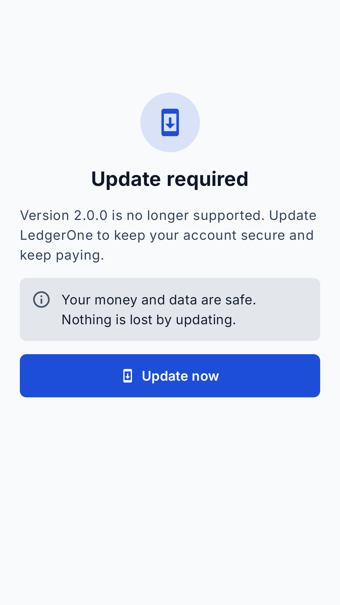 | 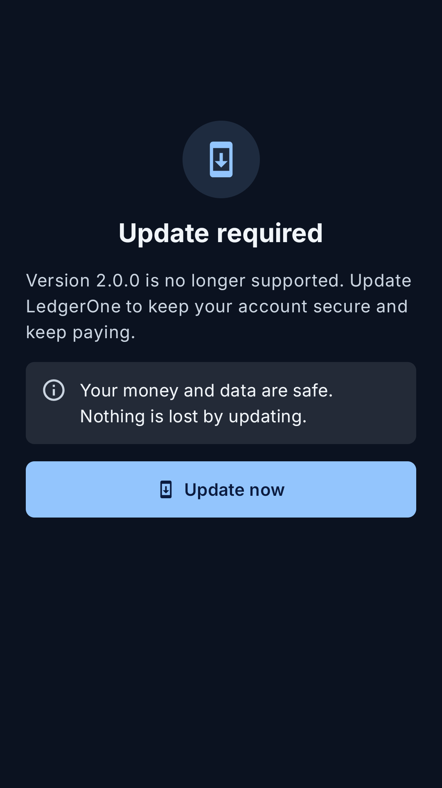 |

## <a id="whats-in-the-app"></a>What's in the app

The app provides four primary navigation tabs:

- **Home:** current bank account balance card (masked by default, tap the eye icon to reveal) and quick actions.
- **Pay:** scan & pay with camera QR scanner, and send to anyone by entering mobile number, UPI ID, choosing from device contacts, or paying utility bills.
- **Passbook:** real-time transaction history stream (`LedgerHistory`) with pagination, debit/credit indicators, category badges, and tap-to-view details.
- **Offers:** dynamic promotional shelves and marketing campaign banners.

Transactions maintain an immutable ledger history to ensure accounting integrity.

Screens below display the light and dark themes on mock data.

### <a id="screen-navigation-flow-diagram"></a>Screen Navigation Flow Diagram

The diagram below maps all screen transitions, authentication barriers, bottom navigation tabs, and sub-flows across the entire application:

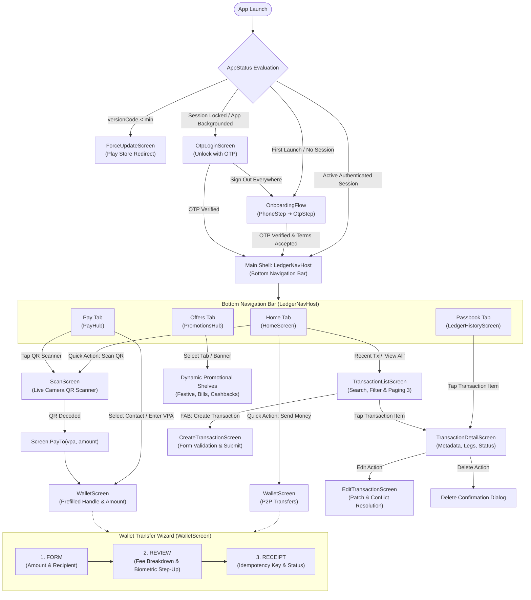

---

### <a id="opening-the-app"></a>Opening the app

| Welcome | Sign in | Update Required (Light) | Update Required (Dark) |
| --- | --- | --- | --- |
| 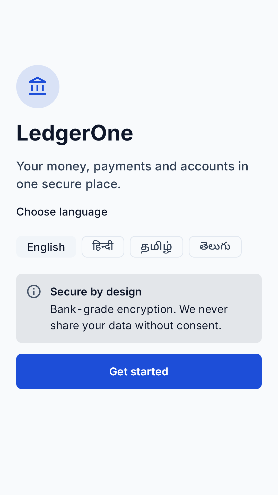 | 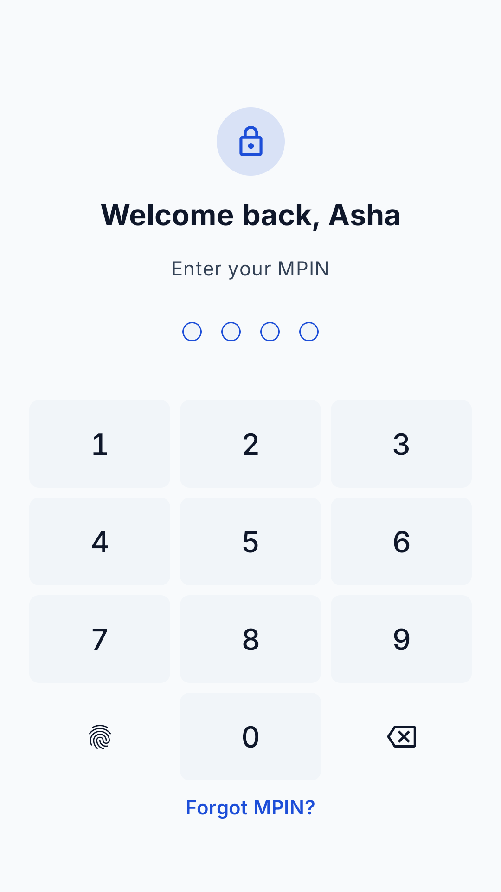 |  |  |

### <a id="primary-navigation-tabs"></a>Primary Navigation Tabs

| Home | Pay | Offers |
| --- | --- | --- |
| 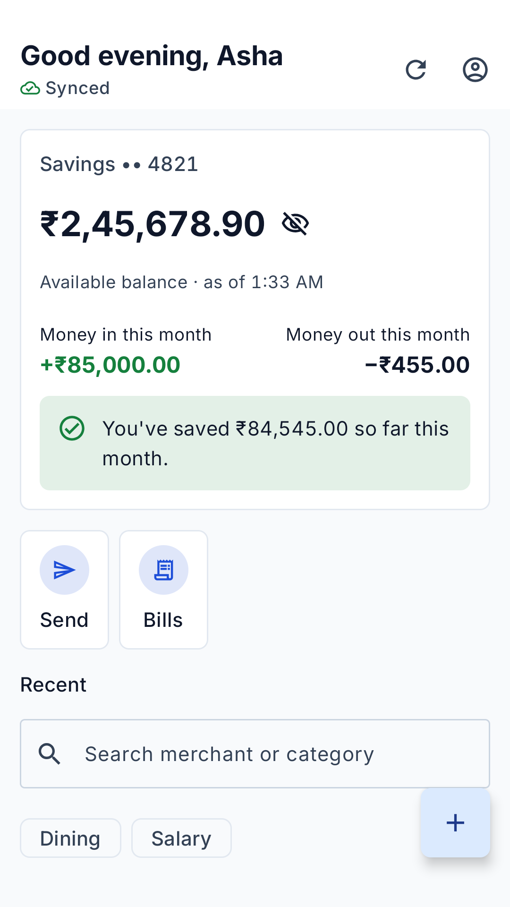 | 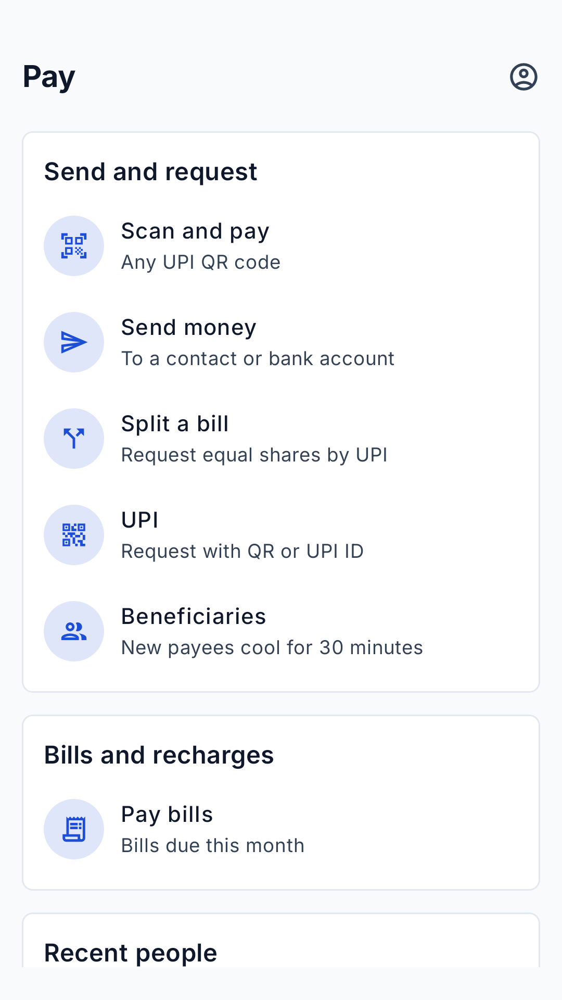 | 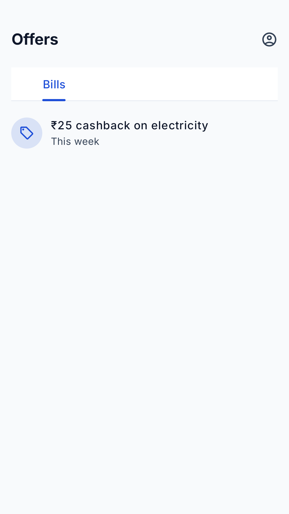 |

### <a id="pay--transfers"></a><a id="pay-transfers"></a>Pay & Transfers

| UPI QR Scanner | Send Money (Wallet) |
| --- | --- |
| 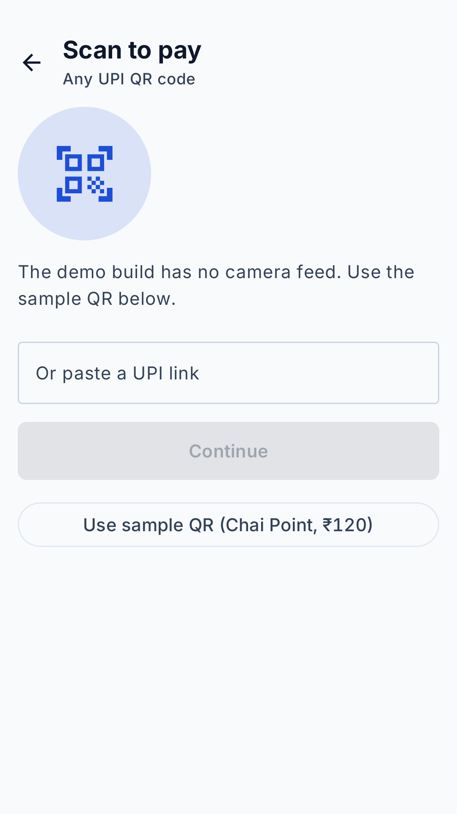 | 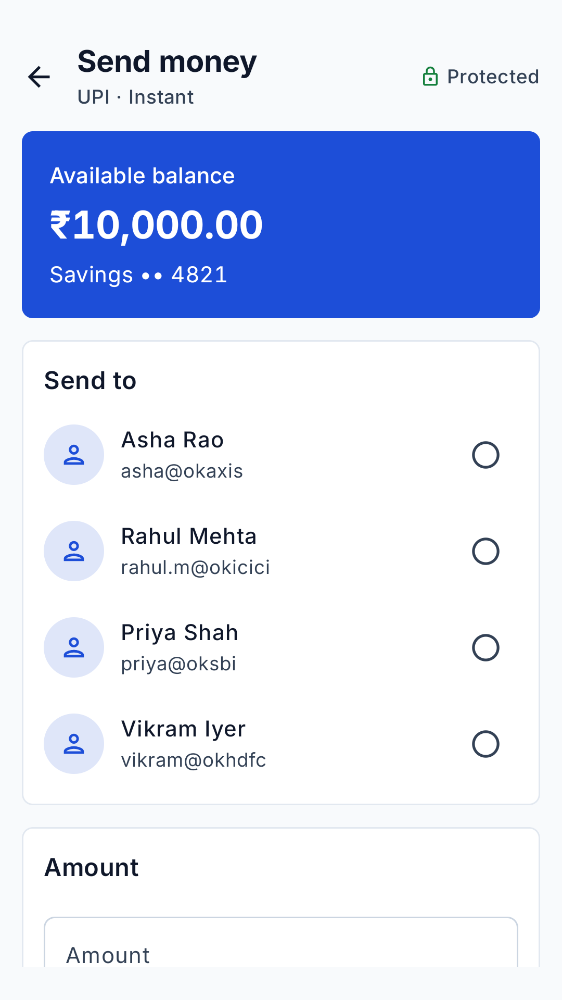 |

### <a id="transactions--double-entry-ledger"></a><a id="transactions-double-entry-ledger"></a>Transactions & Double-Entry Ledger

| Transactions Stream | Transaction Details & Legs | New Transaction | Edit Transaction |
| --- | --- | --- | --- |
| 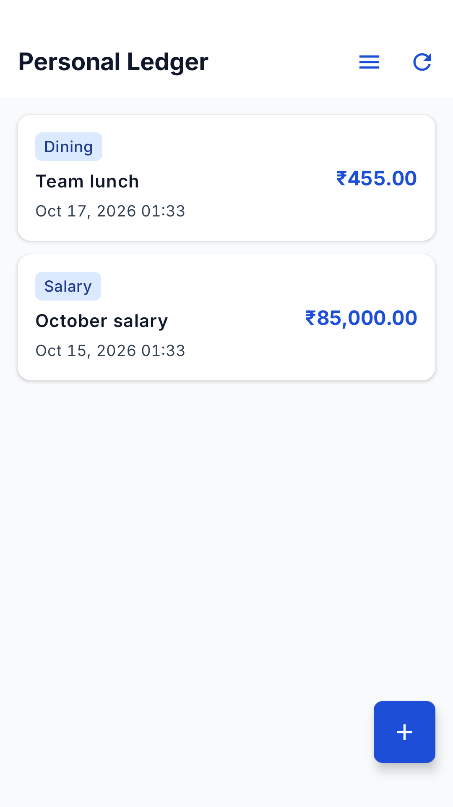 | 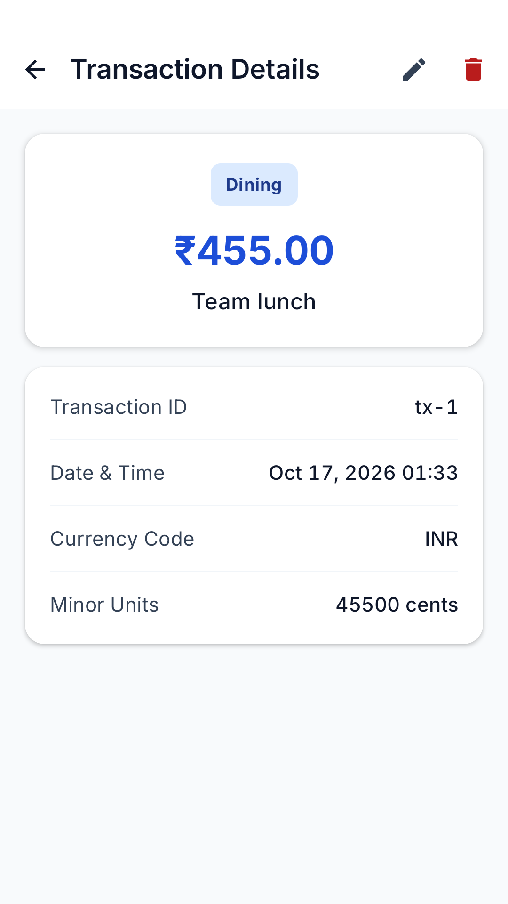 | 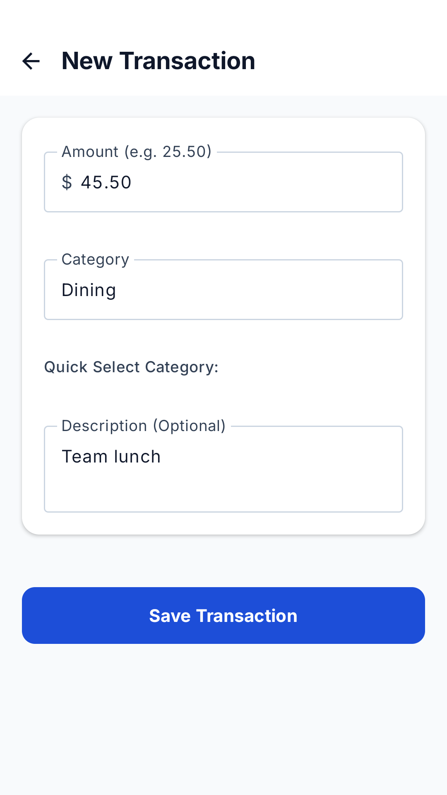 | 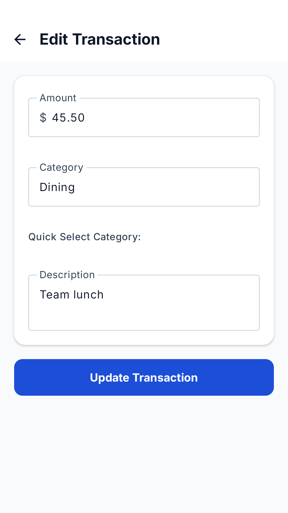 |

## <a id="project-layout"></a>Project layout

The application is structured into a modular multi-tier hierarchy to enforce separation of concerns, build scalability, and strict feature isolation:

| Module / Path | Layer | Responsibility & Capabilities | Key Technologies & Files |
|---|---|---|---|
| **`app/`** | App Shell | Top-level application shell, navigation graph (`Screen`), build flavors, DI wiring, and application-level flows (`ui/app`: auth, hubs, scan) | `LedgerOneApp.kt`, `LedgerNavHost.kt`, `RepositoryModule.kt` |
| **`core/model/`** | Domain (Pure Kotlin) | Domain models (`Transaction`, `Money`), abstract repository interfaces, Use Cases, and core business rules (`Rules.kt`) | `Transaction.kt`, `Rules.kt`, `SendOtpUseCase.kt` |
| **`core/network/`** | Data (Remote) | Retrofit REST API, serialization DTOs, auth interceptor, TLS certificate pinning, and device binding | `TransactionApi.kt`, `SafeApiCall.kt`, `DeviceBinding.kt` |
| **`core/database/`** | Data (Local) | Room database, schema migrations, offline-first repository, WorkManager sync worker, and DataStore preferences | `LedgerDatabase.kt`, `TransactionDao.kt`, `TransactionSyncWorker.kt` |
| **`core/designsystem/`** | Design System | Theme, semantic financial colors, typography roles, money formatting, and shared Compose components (`FeatureScaffold`, keypad, banners) | `Theme.kt`, `Color.kt`, `FeatureScaffold.kt`, `Money.kt` |
| **`core/ui/`** | UI Utilities | Shared Compose UI effects, lifecycle helpers, and window security utilities (`SecureWindow` for screenshot blocking) | `SecureWindow.kt` |
| **`core/mock/`** | Mock & Demo | Mock backend, seeded demo catalog (`MockCatalog`), mock credentials (`MockValues`), and testing levers (`MockSwitches`) | `MockValues.kt`, `MockCatalog.kt`, `MockSwitches.kt` |
| **`core/testing/`** | Test Fixtures | Shared test samples, test dispatchers, and scripted mock coordinators | `Samples.kt` |
| **`feature/<name>/`** | Feature Modules | Distinct product features (one module per feature: `:feature:ledger`, `:feature:wallet`) | `HomeScreen.kt`, `WalletScreen.kt` |
| **`docs/`** | Documentation | Architectural Decision Records (MADRs), architecture documentation, and module integration guidelines | `docs/ARCHITECTURE.md`, `docs/MODULES.md` |

> [!IMPORTANT]
> **Strict Feature Isolation Rule:**
> Feature modules never depend on each other; `ModuleBoundaryTest` fails the build if one does. 
> - See [docs/ARCHITECTURE.md](docs/ARCHITECTURE.md) for how the pieces fit together.
> - See [docs/MODULES.md](docs/MODULES.md) to add a `core/` or `feature/` module.

## <a id="architecture--how-the-app-works"></a><a id="architecture-how-the-app-works"></a>Architecture & How the app works

The application is built according to **Clean Architecture** principles and the official **Android Architecture Guidelines** (as showcased in `android/architecture-samples`), enforcing strict layer boundaries, dependency inversion, and an **offline-first** reactive data flow:

```mermaid
flowchart TD
    subgraph Presentation ["Presentation Layer (:feature:*, :app)"]
        UI["Compose UI Screens (Stateless)"]
        VM["ViewModels (StateFlow<UiState>)"]
        UI -->|UI Events / User Actions| VM
        VM -->|collectAsStateWithLifecycle()| UI
    end

    subgraph Domain ["Domain Layer (:core:model) - Pure Kotlin"]
        UC["Use Cases (Single Responsibility)\n(e.g., GetTransactionsUseCase, SendOtpUseCase)"]
        RepoInt["Repository Interfaces\n(e.g., TransactionRepository, PromotionRepository)"]
        DomainModels["Domain Entities & Invariants\n(e.g., Transaction, OtpResponse)"]
        VM -->|Invoke| UC
        UC -->|Execute Rules & Query| RepoInt
    end

    subgraph Data ["Data Layer (:core:database, :core:network)"]
        RepoImpl["Repository Implementations\n(OfflineTransactionRepository, OfflinePromotionRepository)"]
        Room["Room Database (DAOs & Entities)\n[Local Offline Source of Truth]"]
        Retrofit["Retrofit 2 Services & SafeApiCall\n[Remote REST Endpoints]"]
        RepoInt <|.. RepoImpl
        RepoImpl -->|Local Read/Write| Room
        RepoImpl -->|safeApiCall & Sync| Retrofit
        Room -.->|Cold Flow<List<Entity>>| RepoImpl
    end
```

---

### <a id="clean-architecture--layer-separation"></a>Clean Architecture & Layer Separation

1. **Domain Layer (`:core:model`) - Pure Business Rules:**
   - Free from any Android framework, Room, or Retrofit dependencies.
   - Contains immutable business models (`Transaction`, `OtpResponse`, `SessionResponse`).
   - Defines abstract repository interfaces (`TransactionRepository`, `PromotionRepository`).
   - Houses reusable, single-responsibility **Use Cases** (`operator fun invoke`):
     - `CreateTransactionUseCase`, `UpdateTransactionUseCase`, `DeleteTransactionUseCase`
     - `GetTransactionsUseCase`, `GetPagedTransactionsUseCase`, `GetTransactionByIdUseCase`
     - `RefreshTransactionsUseCase`, `SendOtpUseCase`, `GetPromotionsUseCase`
2. **Data Layer (`:core:database`, `:core:network`):**
   - Implements domain repository interfaces and isolates database/network implementation details.
   - Encapsulates Room DAOs and database entities (`com.ledger.personal.data.local`).
   - Encapsulates Retrofit REST API services, HTTP interceptors, DTOs, and serialization (`com.ledger.personal.data.remote`).
3. **Presentation Layer (`:feature:*`, `:app`):**
   - Feature modules never depend directly on Room DAOs or Retrofit services.
   - ViewModels interact exclusively with domain Use Cases or Repository interfaces.
   - ViewModels expose read-only, immutable `StateFlow<UiState>` models representing the UI state.
   - Composables are declarative and stateless, consuming state using `collectAsStateWithLifecycle()`.

---

### <a id="how-api-calls--network-flow-work-retrofit--safeapicall"></a>How API Calls & Network Flow Work (Retrofit & SafeApiCall)

Network communication follows a robust, safe pattern inspired by `android/architecture-samples`:

1. **Type-Safe Retrofit Services (`:core:network`):**
   HTTP endpoints are declared using standard Retrofit suspend functions:
   ```kotlin
   interface OtpApi {
       @POST("auth/otp")
       suspend fun sendOtp(@Body request: OtpRequest): Response<OtpResponseDto>
   }
   ```
2. **Standardized Error Handling with `safeApiCall`:**
   Raw network executions are wrapped in `safeApiCall { ... }`, which intercepts HTTP error codes, non-2xx bodies, timeouts, and JSON serialization failures, safely catching exceptions and propagating coroutine cancellation:
   ```kotlin
   suspend fun <T : Any> safeApiCall(
       dispatcher: CoroutineDispatcher = Dispatchers.IO,
       apiCall: suspend () -> Response<T>,
   ): Result<T> = withContext(dispatcher) {
       try {
           val response = apiCall()
           if (response.isSuccessful) {
               val body = response.body()
               if (body != null) Result.success(body)
               else Result.failure(ApiException(response.code(), "Empty response body"))
           } else {
               val message = response.errorBody()?.string()?.ifBlank { response.message() } ?: "HTTP ${response.code()}"
               Result.failure(ApiException(response.code(), message))
           }
       } catch (e: CancellationException) {
           throw e // Never swallow coroutine cancellation
       } catch (e: Exception) {
           Result.failure(e)
       }
   }
   ```
3. **DTO to Domain Transformation (Anti-Corruption Layer):**
   DTOs received from the wire are immediately mapped to pure domain models before leaving the network layer (e.g. `TransactionDto.toDomain()`, `OtpResponseDto.toDomain()`).

---

### <a id="how-ui-is-updated-unidirectional-data-flow--stateflow"></a>How UI is Updated (Unidirectional Data Flow & StateFlow)

The UI follows the **Unidirectional Data Flow (UDF)** pattern: **State flows down, events flow up**.

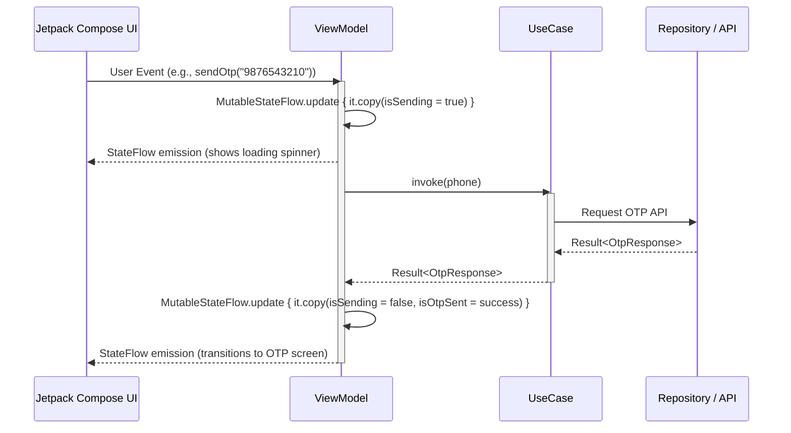

#### Step-by-Step Flow:
1. **User Action / Intent:** The user interacts with a Compose screen (e.g., clicks "Send OTP" in `PhoneStep.kt`). The screen hoists the event to the ViewModel: `viewModel.sendOtp(phone)`.
2. **State Transition to Loading:** The ViewModel immediately issues an atomic state update via `MutableStateFlow.update { it.copy(isSending = true, errorMessage = null) }`.
3. **Domain Business Logic Execution:** The ViewModel executes the Use Case (`sendOtpUseCase(phone)`). The Use Case performs business validation (e.g., verifying 10-digit format) before delegating to the data layer.
4. **Data Fetching / Persistence:** The repository executes the Retrofit call via `safeApiCall` and returns `Result<OtpResponse>`.
5. **State Transition to Success / Error:** The ViewModel updates its internal `MutableStateFlow`:
   ```kotlin
   val result = sendOtpUseCase(phone)
   mutableOtpState.update {
       it.copy(
           isSending = false,
           isOtpSent = result.isSuccess,
           sentMessage = result.getOrNull()?.message?.ifBlank { "OTP sent" } ?: "OTP sent",
           errorMessage = result.exceptionOrNull()?.message,
       )
   }
   ```
6. **Lifecycle-Safe UI Recomposition:** The composable observes `viewModel.otpState.collectAsStateWithLifecycle()`. Compose safely recomposes only the elements that depend on the changed fields (`isSending`, `isOtpSent`, `errorMessage`).

---

### <a id="1-offline-first-local-source-of-truth"></a>1. Offline-first local source of truth

- **Immediate Local Persistence:** Every user write (transaction creation, draft changes, bill payments) is immediately persisted to the local **Room** database with an atomic synchronization status:
  - `SYNCED`: Clean state in sync with server.
  - `PENDING_CREATE`: Created offline, awaiting remote POST.
  - `PENDING_UPDATE`: Modified offline, awaiting remote PATCH.
  - `PENDING_DELETE`: Deleted offline, awaiting remote DELETE.
- **Reactive UI Flow:** Screens never read directly from network endpoints. Jetpack Compose screens observe read-only `StateFlow` streams exposed by ViewModels, which in turn collect cold `Flow` emissions directly from Room DAOs. This guarantees instantaneous UI updates with zero perceived network lag and seamless offline functionality.

---

### <a id="2-resilient-background-synchronization--conflict-resolution"></a><a id="2-resilient-background-synchronization-conflict-resolution"></a>2. Resilient background synchronization & conflict resolution

- **WorkManager Scheduling:** **WorkManager** schedules `TransactionSyncWorker` with network constraints (`NetworkType.CONNECTED`) to guarantee background delivery even across app restarts and device reboots.
- **Exponential Backoff & Idempotency:** Pending local mutations are pushed with exponential backoff (`withRetry`). Network calls use unique, client-generated idempotency keys (`TransferBook`) to prevent duplicate transactions during retries.
- **Three-Way Merge & Conflict Resolution:** Remote changes are pulled and merged into Room without overwriting local un-synced edits. When a server responds with `409 Conflict`, the competing states are diverted into `ConflictInbox` for side-by-side user resolution.

---

### <a id="3-build-flavor-dependency-injection"></a>3. Build flavor dependency injection

Dagger Hilt dynamically binds repositories and network clients based on the active build flavor:

| Build Flavor | Repository Implementation | Network Client / Data Source | Security & Inspection Levers |
|---|---|---|---|
| **`mockDebug`** | `MockTransactionRepository` | In-memory seeded catalog (accounts, contacts, transactions) | `MockSwitches` for latency, errors, and offline simulation |
| **`dev`** / **`staging`** / **`prod`** | `TransactionsRepository` | Remote HTTPS endpoints via Retrofit | TLS certificate pinning, hardware-backed ECDSA device binding |

---

### <a id="4-multi-layer-banking-security"></a>4. Multi-layer banking security

- **MPIN & Keystore Protection:** MPIN keys are stretched with PBKDF2 (600,000 iterations) and sealed using Android Keystore keys.
- **Biometric Device Binding:** Devices register hardware-backed ECDSA P-256 keys in the Keystore, signing cryptographic server challenge nonces (`SHA256withECDSA`) upon biometric verification.
- **Window Protection (`SecureWindow`):** Sensitive screens dynamically block screenshot capture and recent-app previews using Android's `FLAG_SECURE`.
- **Inactivity Session Lock:** Background timer automatically locks the authenticated session after 30 seconds of inactivity to protect against unauthorized physical access.

## <a id="view-models"></a>View models

Screens bind to state-holding Jetpack `ViewModel`s scoped to the navigation back stack or the Activity lifecycle. State is exposed as read-only `StateFlow`s, and all asynchronous work runs structured in `viewModelScope`.

| Module | ViewModel | Responsibility |
| `:app` | `AppViewModel` | Top-level app shell lifecycle, version/update evaluation, session lock state, and category availability (adhering to SRP) |
| `:app` | `OnboardingViewModel` | User onboarding registration, phone input verification, and SMS OTP dispatch |
| `:app` | `LoginViewModel` | Locked screen OTP verification, session unlock authorization, and device account reset |
| `:app` | `DemoViewModel` | Mock environment switches and connection status for testing |
| `:app` | `PromotionsViewModel` | Marketing promotional tabs and offer banners |
| `:feature:ledger` | `HomeViewModel` | Dashboard balances, recent transactions, pull-to-refresh sync, and dynamic layout tabs |
| `:feature:ledger` | `TransactionListViewModel` | Searchable, category-filtered, paginated transaction history via Paging 3 |
| `:feature:ledger` | `TransactionDetailViewModel` | Single transaction inspection, metadata loading, and retry |
| `:feature:ledger` | `CreateTransactionViewModel` | Transaction creation form validation and submission |
| `:feature:ledger` | `EditTransactionViewModel` | Transaction editing, draft state, and conflict handling |
| `:feature:ledger` | `LedgerHistoryViewModel` | Reactive audit log stream observing `GetPagedTransactionsUseCase` |
| `:feature:wallet` | `WalletViewModel` | P2P wallet transfers, step-up authentication, idempotency (`TransferBook`), and retry |

## <a id="state-management-remember-remembersaveable--app-state-architecture"></a><a id="state-management-remember-remembersaveable-app-state-architecture"></a>State Management: `remember`, `rememberSaveable` & App State Architecture

State in this application represents any data that can change over time and causes the UI to update. Because Android components undergo configuration changes (e.g. device rotation, theme switching, language change) and system-initiated background process termination, the application manages state across a structured **4-tier hierarchy**:

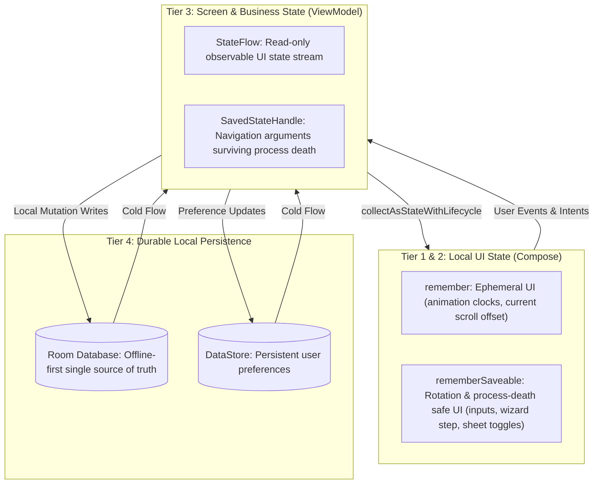

---

### <a id="1-understanding-mutablestateof-compose-snapshot-state"></a>1. Understanding `mutableStateOf`: Compose Snapshot State Engine

In Jetpack Compose, the user interface is a direct reactive projection of state: $\text{UI} = f(\text{State})$. Standard Kotlin variables (`var count = 0`) are invisible to the Compose runtime; changing their value does not trigger UI recomposition.

`mutableStateOf(value)` is the foundational primitive that creates an observable **`MutableState<T>`** instance integrated into Compose's **Snapshot State System**.

#### A. How `mutableStateOf` Triggers Recomposition
When a `@Composable` function executes, Compose automatically tracks every `State` property read within that composable's scope:
1. **Read Tracking:** When a composable accesses `state.value`, the Snapshot runtime logs the current composable as an active subscriber.
2. **Write Notification:** When `state.value = newValue` is modified, the Snapshot system marks the state as invalid.
3. **Smart Recomposition:** Compose automatically schedules a recomposition **only** for the specific composables that read that property, skipping all unaffected sibling and parent UI components.

```kotlin
// Core Compose runtime state interfaces
interface State<out T> {
    val value: T
}

interface MutableState<T> : State<T> {
    override var value: T
}
```

#### B. Syntax: Direct Assignment (`=`) vs Property Delegation (`by`)
In Kotlin, you can consume `mutableStateOf` in two distinct styles:

| Style | Syntax | Read Access | Write Access | Use Case in LedgerOne |
|---|---|---|---|---|
| **Property Delegation (`by`)** | `var input by rememberSaveable { mutableStateOf("") }` | `input` | `input = "new"` | **Standard pattern** across forms and screens. Eliminates boilerplate `.value` calls. |
| **Direct Assignment (`=`)** | `val input = rememberSaveable { mutableStateOf("") }` | `input.value` | `input.value = "new"` | Useful when passing the `MutableState` handle itself down to state holders or helper classes. |

> **Note:** The `by` delegate syntax requires importing the runtime extension operators:
> ```kotlin
> import androidx.compose.runtime.getValue
> import androidx.compose.runtime.setValue
> ```

#### C. Why `mutableStateOf` Must Be Paired with `remember` or `rememberSaveable`
Calling `mutableStateOf(initialValue)` by itself creates a new snapshot state object. However, composables execute repeatedly during recomposition.
- **Without `remember`:**
  ```kotlin
  // ANTIPATTERN: A brand-new state object is instantiated on EVERY recomposition!
  var text by mutableStateOf("") // Every recomposition wipes the user's typing and resets to ""
  ```
- **With `remember`:**
  ```kotlin
  // Stored in the composition slot table; survives recompositions
  var text by remember { mutableStateOf("") }
  ```
- **With `rememberSaveable`:**
  ```kotlin
  // Preserved in Android's SavedStateRegistry; survives rotation and process death
  var text by rememberSaveable { mutableStateOf("") }
  ```

#### D. Primitive Specializations (Zero Auto-Boxing Overhead)
To eliminate Garbage Collection churn and heap allocations caused by Java primitive autoboxing (`Integer`, `Long`, `Float`, `Boolean`), Compose provides dedicated primitive state creators:

| Function | Return Type | Underlying Primitive | LedgerOne Production Example |
|---|---|---|---|
| **`mutableIntStateOf(0)`** | `MutableIntState` | `Int` (unboxed) | SMS OTP countdown timer (`seconds` in `Login.kt`), selected tab index |
| **`mutableLongStateOf(0L)`** | `MutableLongState` | `Long` (unboxed) | Financial minor unit calculations (paise), timestamp offsets |
| **`mutableFloatStateOf(0f)`** | `MutableFloatState` | `Float` (unboxed) | Swipe dismiss offsets, transition progress ratios |
| **`mutableBooleanStateOf(false)`** | `MutableBooleanState` | `Boolean` (unboxed) | Dialog visibility toggles, balance reveal flags |

#### E. Mutation Policies (`SnapshotMutationPolicy`)
`mutableStateOf` accepts an optional `SnapshotMutationPolicy` controlling whether writing a value is considered a real change:
- **`structuralEqualityPolicy()` (Default):** Compares old and new values using `.equals()` (`==`). If `state.value = "abc"` is assigned `"abc"`, no recomposition is scheduled.
- **`referentialEqualityPolicy()`:** Compares values using object identity reference (`===`).
- **`neverEqualPolicy()`:** Treats every single write as a mutation, forcing recomposition even if values match.

---

### <a id="2-remember-vs-remembersaveable"></a>2. `remember` vs `rememberSaveable`

| Mechanism | Survives Recomposition? | Survives Device Rotation? | Survives Process Death? | Where Data Is Stored |
|---|---|---|---|---|
| **`remember { ... }`** | **Yes** | ❌ **No** (resets to initial) | ❌ **No** | Composition memory tree |
| **`rememberSaveable { ... }`** | **Yes** | **Yes** (restored) | **Yes** (restored) | Android `SavedStateRegistry` (`Bundle`) |

#### Why `remember` Alone Is Not Enough
In Compose, `remember { mutableStateOf(initialValue) }` keeps state alive across recompositions. However, when a user rotates their device or toggles dark mode, the host Android `Activity` is completely destroyed and recreated. All plain `remember` allocations are wiped out and reset to their initial value.

#### How `rememberSaveable` Works Under the Hood
`rememberSaveable` saves and restores values via Android's **`SavedStateRegistry`** (the same underlying mechanism as `onSaveInstanceState(Bundle)`):
1. **During execution:** Reads and mutates the in-memory state object like standard `remember`.
2. **On configuration change or background process termination:** Serializes the value into the Android `Bundle`.
3. **Upon recreation:** Restores the saved value from the `Bundle` instead of resetting to the default initializer.

> **Supported Types:** Primitives (`Int`, `Long`, `Float`, `Boolean`), `String`, `Bundle`, and `Parcelable` are supported automatically. Custom complex objects can be saved by supplying a custom Compose `Saver` (`rememberSaveable(stateSaver = ...)`).

---

### <a id="3-real-world-uses-of-remembersaveable-in-ledgerone"></a>3. Real-World Uses of `rememberSaveable` in LedgerOne

#### A. Transient Form Inputs & Typing Buffers
Users should not lose their input while filling forms if they rotate their screen before pressing submit.
- **Wallet transfer amount input (`WalletScreen.kt`):**
  ```kotlin
  var amountText by rememberSaveable { mutableStateOf(initialAmount) }
  ```
- **Quick recipient input (`PayHub.kt`):**
  ```kotlin
  var recipientInput by rememberSaveable { mutableStateOf("") }
  ```

#### B. Multi-Step Wizard Progression
Prevents multi-step flows from resetting back to the very first step upon device rotation.
- **Onboarding flow step (`Onboarding.kt`):**
  ```kotlin
  var step by rememberSaveable { mutableStateOf(OnboardStep.PHONE) }
  var phone by rememberSaveable { mutableStateOf("") }
  ```

#### C. Bottom Sheet & Dialog Visibility Toggles
Ensures that open modals and confirmation dialogs remain open during configuration changes.
- **Transaction delete confirmation dialog (`TransactionDetailScreen.kt`):**
  ```kotlin
  var showDeleteDialog by rememberSaveable { mutableStateOf(false) }
  ```

#### D. Authentication Resend Countdown Timers
Preserves the remaining seconds on SMS OTP cooldowns across activity recreation (`Login.kt`):
```kotlin
var seconds by rememberSaveable { mutableIntStateOf(RESEND_SECONDS) }
```

#### E. Scroll Position & Viewport Form Access (`rememberScrollState`)
In Jetpack Compose, standard containers like `Column` and `Row` are **not scrollable by default**. If content exceeds the physical height of the screen, it is simply clipped unless a scroll modifier is attached.

`rememberScrollState()` creates and remembers a `ScrollState` instance to make layout columns scrollable via `Modifier.verticalScroll(rememberScrollState())`. Under the hood, Compose implements it directly on top of `rememberSaveable`:
```kotlin
@Composable
fun rememberScrollState(initial: Int = 0): ScrollState {
    return rememberSaveable(saver = ScrollState.Saver) {
        ScrollState(initial = initial)
    }
}
```

##### Why `rememberScrollState` is Critical in LedgerOne:
1. **Preventing Content Clipping Across Varied Screen Sizes:**
   Android runs on thousands of screen resolutions, aspect ratios, and split-screen multi-window modes. In `CreateTransactionScreen.kt` and `EditTransactionScreen.kt`, input forms contain amount fields, category chips, notes, and action buttons. Attaching `.verticalScroll(rememberScrollState())` guarantees that all content remains accessible regardless of screen height.
2. **On-Screen Keyboard (IME) Inset Adaptation:**
   When a user taps an input field to enter an amount, name, or phone number, the software keyboard rises, consuming over 40–50% of the display height. Combined with `Modifier.safeDrawingPadding()`, `rememberScrollState()` allows the container to compress and scroll smoothly, preventing primary submission buttons and text fields from being trapped behind the keyboard (`PhoneStep.kt`, `OtpStep.kt`, `Onboarding.kt`).
3. **Surviving Screen Rotation & Process Death:**
   Because `rememberScrollState()` delegates to `rememberSaveable` with `ScrollState.Saver`, the user's exact scroll offset (in pixels) is serialized into the Android `Bundle`. If a user rotates their device midway through filling out a transaction form or onboarding flow, their viewport position is seamlessly restored rather than resetting back to the top.
4. **Programmatic Scrolling & Observability:**
   `ScrollState` exposes both reactive properties (`value`, `maxValue`, `isScrollInProgress`) and suspend functions (`scrollTo(position)`, `animateScrollTo(position)`). This allows composables to observe user scrolling activity (e.g., dynamically elevating top app bars) and programmatically scroll to validation errors.
5. **Architectural Choice: `rememberScrollState` vs `rememberLazyListState`:**
   - **`rememberScrollState()` with `Column`:** Used for fixed-size, moderate-length layouts where all elements are known and should be kept in the composition simultaneously (forms, auth steps, modal dialogs, `FeatureScaffold`).
   - **`rememberLazyListState()` with `LazyColumn`:** Used for large or unbounded data streams (such as `TransactionListScreen` and `LedgerHistory`), where list items must be virtualized and recycled on-demand to avoid memory bloat.

##### Key Usages in LedgerOne:
- **Shared feature scaffold (`FeatureScaffold.kt`):**
  ```kotlin
  modifier = (if (scrollable) base.verticalScroll(rememberScrollState()) else base)
  ```
- **Transaction creation & editing forms (`CreateTransactionScreen.kt` & `EditTransactionScreen.kt`):**
  ```kotlin
  Column(
      modifier = Modifier
          .fillMaxSize()
          .verticalScroll(rememberScrollState())
          .padding(16.dp),
      verticalArrangement = Arrangement.spacedBy(16.dp),
  )
  ```
- **Onboarding and authentication wizards (`Onboarding.kt`, `PhoneStep.kt`, `OtpStep.kt`):**
  ```kotlin
  Modifier.safeDrawingPadding().verticalScroll(rememberScrollState()).padding(24.dp)
  ```

---

### <a id="4-screen--business-state-viewmodel--stateflow"></a><a id="4-screen-business-state-viewmodel-stateflow"></a>4. Screen & Business State: `ViewModel` + `StateFlow`

While `rememberSaveable` handles screen-level UI state, domain logic and async data are owned by Hilt-injected `ViewModel`s:
- **`StateFlow` for UI State:** ViewModels expose a single, immutable `StateFlow<UiState>` using `stateIn(SharingStarted.WhileSubscribed(5_000))`. The 5-second timeout keeps the upstream flow active across brief configuration changes without restarting expensive Room queries.
- **Atomic State Updates:** Mutations apply atomically using `MutableStateFlow.update { it.copy(...) }`, eliminating race conditions between concurrent coroutines.
- **`SavedStateHandle` for Process Death:** Navigation arguments (e.g. `transactionId` in `TransactionDetailViewModel.kt`) are retrieved from `SavedStateHandle`, ensuring the screen can re-fetch its data even after Android kills the process in the background.

---

### <a id="5-architectural-patterns-used-across-the-project"></a>5. Architectural Patterns Used Across the Project

#### <a id="a-state-hoisting-unidirectional-data-flow"></a>A. State Hoisting (Unidirectional Data Flow)
In Compose screens, stateful containers are separated from stateless presentation components:
- **State flows down:** Child composables receive immutable values via arguments (`value: String`, `enabled: Boolean`).
- **Events flow up:** Child composables emit user intents through callback lambdas (`onValueChange: (String) -> Unit`, `onSubmit: () -> Unit`).
- **Benefit:** Child components are 100% previewable with `@PreviewLightDark` and unit-testable in isolation.

#### <a id="b-collectasstatewithlifecycle-vs-collectasstate"></a>B. `collectAsStateWithLifecycle()` vs `collectAsState()`
All screens consume ViewModel `StateFlow`s using `collectAsStateWithLifecycle()`.
- **Why?** Plain `collectAsState()` continues collecting flow emissions in the background even when the app is minimized. `collectAsStateWithLifecycle()` automatically suspends collection when the screen drops below `Lifecycle.State.STARTED`, preventing battery drain and background work.

#### <a id="c-edge-to-edge-window-inset-management-safedrawingpadding"></a>C. Edge-to-Edge Window Inset Management (`safeDrawingPadding`)
Modern Android applications draw **edge-to-edge** by default (`enableEdgeToEdge()`), allowing background surfaces and gradients to bleed seamlessly beneath the system status bar and gesture navigation bar. However, interactive UI components (buttons, headers, text inputs) must never be obstructed by system furniture or physical hardware contours.

`Modifier.safeDrawingPadding()` applies dynamic padding matching `WindowInsets.safeDrawing`, which is the union of four critical system boundaries:
1. **Status Bar (top):** Prevents titles and icons from colliding with the device clock, battery indicator, or network icons.
2. **Navigation Bar (bottom):** Prevents primary action buttons from overlapping the gesture bar pill or 3-button navigation area.
3. **Display Cutouts & Notches:** Protects content from being masked by camera punch-holes, teardrop notches, and rounded corner radii.
4. **Software Keyboard (IME - Input Method Editor):** Unlike older `Modifier.systemBarsPadding()` (which only considers status/navigation bars), `safeDrawingPadding()` dynamically incorporates `WindowInsets.ime`. When the software keyboard slides up, the bottom padding instantly and smoothly expands to push up the content.

##### The Power of Combining `safeDrawingPadding()` with `rememberScrollState()`
In authentication and transaction entry screens, chaining:
```kotlin
Modifier
    .safeDrawingPadding()
    .verticalScroll(rememberScrollState())
    .padding(24.dp)
```
produces a resilient UI container:
- `safeDrawingPadding()` keeps the outer bounds of the screen completely clear of camera cutouts, navigation bars, and the keyboard.
- `rememberScrollState()` ensures that when the keyboard takes up 40–50% of the screen height, the user can freely scroll the remaining form fields, helper text, and CTA buttons into comfortable view.

##### Key Usages in LedgerOne:
- **Mandatory App Update Dialog (`ForceUpdate.kt`):** Ensures critical update messaging is never clipped by top camera cutouts or bottom navigation pills:
  ```kotlin
  Modifier.safeDrawingPadding().padding(24.dp)
  ```
- **Login Screen (`Login.kt`):** Centers authentication cards safely away from system bars:
  ```kotlin
  Modifier.safeDrawingPadding().padding(24.dp)
  ```
- **Onboarding & OTP Flow (`Onboarding.kt`, `PhoneStep.kt`, `OtpStep.kt`):**
  ```kotlin
  Modifier.safeDrawingPadding().verticalScroll(rememberScrollState()).padding(24.dp)
  ```

#### <a id="d-layout-flow-main-axis-arrangements-vs-cross-axis-alignments-in-column--row"></a><a id="d-layout-flow-main-axis-arrangements-vs-cross-axis-alignments-in-column-row"></a>D. Layout Flow: Main Axis Arrangements vs Cross Axis Alignments in `Column` & `Row`
In Jetpack Compose, the placement of child composables is governed by two orthogonal axes:
- **`Column`:** Main Axis runs **vertically (&#8595;)**, Cross Axis runs **horizontally (&#8594;)**.
- **`Row`:** Main Axis runs **horizontally (&#8594;)**, Cross Axis runs **vertically (&#8595;)**.

> **Rule of Thumb:**
> - **`Arrangement`** dictates **spacing, distribution, and layout flow along the Main Axis**.
> - **`Alignment`** dictates **positioning across the Cross Axis**.

<p align="center">
  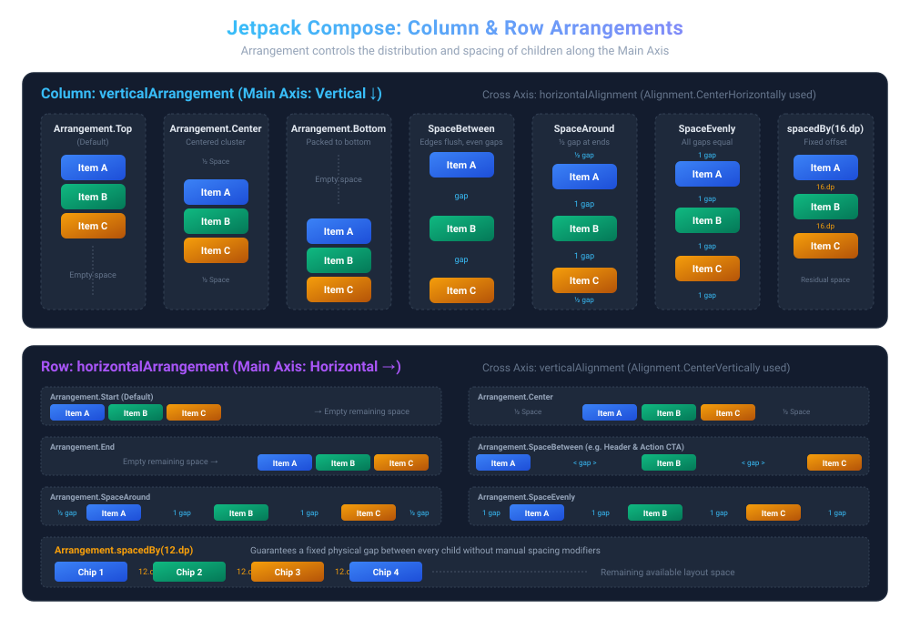
</p>

##### Comparison of Arrangement Modes

| Arrangement Mode | Visual Distribution Behavior | Common Production Use Case |
|---|---|---|
| **`Arrangement.Top` / `Start`** | Packs all children flush to the start of the layout. Any extra space remains at the end. (Default) | Standard vertical reading content, forms, documents |
| **`Arrangement.Center`** | Groups all children tightly together in the exact middle of the available space. | Centered loading spinners, empty state illustrations, PIN verification dials |
| **`Arrangement.Bottom` / `End`** | Packs all children flush against the bottom or end edge. | Sticky bottom action bars, trailing action icon clusters |
| **`Arrangement.SpaceBetween`** | Pins the first child to the very start edge, the last child to the end edge, and divides all free space equally between interior items (zero space at the outer boundaries). | Card headers with trailing actions, transaction summary rows (`Title` on left, `₹Amount` on right) |
| **`Arrangement.SpaceAround`** | Distributes available space evenly between children, placing **half-sized space** at the start and end edges. | Social share buttons, 3-step timeline indicators |
| **`Arrangement.SpaceEvenly`** | Distributes available space such that **all gaps** (start margin, inter-child gaps, and end margin) are **100% equal**. | Evenly spaced dashboard navigation tiles, keypad rows |
| **`Arrangement.spacedBy(dp)`** | Places a fixed, precise physical gap (e.g. `16.dp`) between adjacent children. Unlike manual `Spacer` elements, `spacedBy` does not add redundant spacing before the first or after the last child. | Vertical form fields, category filter chip rows, list cards |

##### Key Examples from LedgerOne Codebase:

1. **`Arrangement.SpaceBetween` for Key-Value Rows (`DetailRow.kt`, `TransactionListScreen.kt`):**
   ```kotlin
   Row(
       modifier = Modifier.fillMaxWidth(),
       horizontalArrangement = Arrangement.SpaceBetween,
       verticalAlignment = Alignment.CenterVertically
   ) {
       LedgerOneText("Transfer Limit", role = LedgerOneTextRole.Body)
       LedgerOneText("₹50,000.00", role = LedgerOneTextRole.Title)
   }
   ```
2. **`Arrangement.spacedBy(dp)` for Form Fields & Carousels (`CreateTransactionScreen.kt`, `HomeScreen.kt`):**
   ```kotlin
   // Vertical form with consistent 16.dp gaps between inputs
   Column(
       modifier = Modifier.fillMaxSize().verticalScroll(rememberScrollState()).padding(16.dp),
       verticalArrangement = Arrangement.spacedBy(16.dp)
   ) {
       LedgerOneTextField(...)
       CategoryPicker(...)
       LedgerOneButton(...)
   }

   // Horizontal category filter carousel with 12.dp gaps
   LazyRow(horizontalArrangement = Arrangement.spacedBy(12.dp)) {
       items(categories) { category -> CategoryChip(category) }
   }
   ```
3. **`Arrangement.Center` for Centered Identity & Loading Hubs (`Onboarding.kt`, `Login.kt`):**
   ```kotlin
   Column(
       horizontalAlignment = Alignment.CenterHorizontally,
       verticalArrangement = Arrangement.spacedBy(12.dp)
   ) {
       AvatarCircle(initials = "SR")
       LedgerOneText("Sourabh Rustagi", role = LedgerOneTextRole.Title)
   }
   ```

---

### <a id="6-application-state-mechanism-comparison-matrix"></a>6. Application State Mechanism Comparison Matrix

| State Tool | Storage Location | Survives Recomposition? | Survives Screen Rotation? | Survives Process Death? | Survives Phone Reboot? | Primary Application Use Case |
|---|---|---|---|---|---|---|
| **`remember`** | Composition Memory | **Yes** | ❌ No | ❌ No | ❌ No | Ephemeral UI: animation clocks, transient gestures |
| **`rememberSaveable`** | `SavedStateRegistry` (Bundle) | **Yes** | **Yes** | **Yes** | ❌ No | Form text fields, wizard step index, dialog/sheet open state |
| **`rememberScrollState`** | `SavedStateRegistry` (`ScrollState.Saver`) | **Yes** | **Yes** | **Yes** | ❌ No | Viewport scroll position in `Column`/`Row`, form keyboard adaptation |
| **`ViewModel` (`StateFlow`)** | `ViewModelStore` (Heap) | **Yes** | **Yes** | ❌ No | ❌ No | Business logic, fetched accounts, live calculations, search queries |
| **`SavedStateHandle`** | `SavedStateRegistry` + ViewModel | **Yes** | **Yes** | **Yes** | ❌ No | Navigation parameters (`transactionId`), search criteria across process death |
| **`Room Database`** | SQLite on Disk | **Yes** | **Yes** | **Yes** | **Yes** | Durable single source of truth: ledger transactions, sync states |
| **`DataStore`** | Disk (`.preferences_pb`) | **Yes** | **Yes** | **Yes** | **Yes** | User preferences: theme mode, masked balance toggle, skipped app version |

## <a id="jetpack-compose-effects--lifecycle-side-effect-handling"></a><a id="jetpack-compose-effects-lifecycle-side-effect-handling"></a>Jetpack Compose Effects & Lifecycle Side-Effect Handling

In Jetpack Compose, composable functions should be fast, pure, and free of side effects. Because composables can recompose frequently, in any order, or be cancelled mid-execution, executing side effects (such as modifying non-Compose state, starting coroutines, registering system callbacks, or allocating system resources) directly inside a composable body can lead to memory leaks, repeated execution, and erratic app state.

Jetpack Compose provides built-in effect APIs to handle side effects in a controlled, lifecycle-aware manner.

---

### <a id="1-disposableeffect-cleanup-aware-side-effects"></a>1. `DisposableEffect` (Cleanup-Aware Side Effects)

`DisposableEffect` is specifically designed for side effects that require **teardown or cleanup** when the composable leaves the composition or when its observation keys change. It is intended for non-coroutine operations such as registering and unregistering listeners, releasing executors, or toggling window flags.

Every `DisposableEffect` must end with an `onDispose { ... }` block where the teardown logic is executed.

#### How `DisposableEffect` works:
1. When entering composition (or when a key changes), the effect block executes.
2. When the composable leaves the composition (or before re-running with new keys), `onDispose` executes first to release held resources.

#### Real-world examples in LedgerOne:

#### A. Window Security (`SecureWindow.kt` in `:core:ui`)
Prevents Android from taking screenshots or showing task switcher previews on sensitive banking screens:

```kotlin
@Composable
fun SecureWindow() {
    val view = LocalView.current
    DisposableEffect(Unit) {
        val window = (view.context as? Activity)?.window
        // 1. Add FLAG_SECURE when the screen enters composition
        window?.addFlags(WindowManager.LayoutParams.FLAG_SECURE)
        
        // 2. Clean up: clear FLAG_SECURE when the screen leaves composition
        onDispose {
            window?.clearFlags(WindowManager.LayoutParams.FLAG_SECURE)
        }
    }
}
```

#### B. Background Session Auto-Lock & Verification (`LedgerOneApp.kt` in `:app`)
Monitors application background lifecycle using AndroidX `LifecycleEventObserver` and auto-locks the session immediately upon backgrounding, enforcing passcode/OTP re-verification before granting access to personal financial data:

- **Immediate Inactivity Lock:** Whenever the user minimizes the app, presses the home button, switches to another app, or turns off the screen (`ON_STOP`), the active session is locked immediately (`sessionManager.end()`, `SessionState.unlocked = false`).
- **Configuration Change Exemption:** Screen rotations and multi-window resizing (`isChangingConfigurations == true`) do not trigger session locks, preventing disruptive verification prompts during normal display adjustments.
- **Immediate Re-Verification on Return:** Upon foregrounding (`ON_START`), the application detects that it was stopped and presents `OtpLoginScreen` (or passcode verification), ensuring zero unauthorized exposure.
- **Unit-Tested:** Validated by `BackgroundLockTest` simulating lifecycle state transitions.

```kotlin
@Composable
private fun LockWhenBackgrounded(onLock: () -> Unit) {
    val owner = LocalLifecycleOwner.current
    val activity = LocalActivity.current
    DisposableEffect(owner) {
        val observer = createBackgroundLockObserver(
            isChangingConfigurations = { activity?.isChangingConfigurations == true },
            onLock = onLock,
        )
        owner.lifecycle.addObserver(observer)
        // Clean up: unregister the lifecycle observer when navigating away
        onDispose { owner.lifecycle.removeObserver(observer) }
    }
}

internal fun createBackgroundLockObserver(
    isChangingConfigurations: () -> Boolean,
    onLock: () -> Unit,
): LifecycleEventObserver {
    var wasStopped = false
    return LifecycleEventObserver { _, event ->
        when (event) {
            Lifecycle.Event.ON_STOP -> {
                if (!isChangingConfigurations()) {
                    wasStopped = true
                    onLock()
                }
            }
            Lifecycle.Event.ON_START -> {
                if (wasStopped) {
                    wasStopped = false
                    onLock()
                }
            }
            else -> Unit
        }
    }
}
```

#### C. Network Connectivity Monitoring (`Link.kt` in `:app`)
Registers an Android system `ConnectivityManager.NetworkCallback` to keep the UI state synchronized with the device's internet connection:

```kotlin
@Composable
fun rememberConnected(): Boolean {
    val context = LocalContext.current
    val manager = remember { context.getSystemService(ConnectivityManager::class.java) }
    var connected by remember { mutableStateOf(hasInternet(manager)) }
    
    DisposableEffect(manager) {
        val callback = object : ConnectivityManager.NetworkCallback() {
            override fun onAvailable(network: Network) { connected = hasInternet(manager) }
            override fun onLost(network: Network) { connected = hasInternet(manager) }
            override fun onCapabilitiesChanged(network: Network, caps: NetworkCapabilities) {
                connected = hasInternet(manager)
            }
        }
        manager.registerDefaultNetworkCallback(callback)
        // Clean up: unregister callback from system service to avoid memory leaks
        onDispose { manager.unregisterNetworkCallback(callback) }
    }
    return connected
}
```

#### D. Camera Executor Teardown (`QrCamera.kt` in `:app`)
Allocates a single-thread background executor to process QR camera frames with ML Kit, shutting down the background executor cleanly when leaving composition:

```kotlin
DisposableEffect(owner) {
    if (context.findActivity() == null) return@DisposableEffect onDispose {}
    val executor = Executors.newSingleThreadExecutor()
    bindQrScanner(context, owner, preview, executor) { raw ->
        if (!done) {
            done = true
            ContextCompat.getMainExecutor(context).execute { onCode(raw) }
        }
    }
    // Clean up: shut down background thread pool when camera view is dismissed
    onDispose { executor.shutdown() }
}
```

#### E. Deep Link Intent Listener (`LedgerNavHost.kt` in `:app`)
Hooks into `ComponentActivity.addOnNewIntentListener` to intercept external payment deep links and passes them to `NavController`:

```kotlin
val activity = LocalActivity.current as? ComponentActivity
if (activity != null) DisposableEffect(activity, navController) {
    val listener = Consumer<Intent> { navController.handleDeepLink(it) }
    activity.addOnNewIntentListener(listener)
    // Clean up: remove the listener when NavHost leaves composition
    onDispose { activity.removeOnNewIntentListener(listener) }
}
```

---

### <a id="2-launchedeffect-coroutine-scoped-side-effects"></a>2. `LaunchedEffect` (Coroutine-Scoped Side Effects)

`LaunchedEffect` executes a suspend block within a `CoroutineScope` tied to the composable's lifecycle.

- **Trigger:** Runs when entering composition or when any of its specified `key` parameters change.
- **Cancellation:** If the composable leaves composition or if a key changes while the coroutine is still running, the existing coroutine is cancelled cooperatively.

#### Real-world examples in LedgerOne:
- **Countdown Timers:** `LaunchedEffect(seconds)` in `Login.kt` and `OtpStep.kt` runs a 1-second delay loop to update OTP resend timers.
- **Dynamic Permission Requests:** `LaunchedEffect(liveCapture)` in `Scan.kt` triggers the Android system camera permission prompt when camera scanning is activated.
- **Deep Link Navigation Prefill:** `LaunchedEffect(prefillHandle, prefillMinor)` in `WalletScreen.kt` pre-populates payee details when launched via UPI intent.
- **Pagination Triggers:** `LaunchedEffect(shouldLoadMore)` in `TransactionListScreen.kt` triggers `viewModel.loadNextPage()` when the user scrolls near the list bottom.

---

### <a id="3-sideeffect-publishing-compose-state-to-non-compose-code"></a>3. `SideEffect` (Publishing Compose State to Non-Compose Code)

`SideEffect` executes after **every successful recomposition**. Unlike `LaunchedEffect`, it does not support coroutines and does not take keys.

- **When to use:** Use `SideEffect` to publish Compose state to external, non-Compose objects (such as analytics managers, custom logging frameworks, or system properties) that do not require cleanup.
- **Example:**
  ```kotlin
  @Composable
  fun ScreenTracker(screenName: String, analytics: AnalyticsTracker) {
      SideEffect {
          analytics.setCurrentScreen(screenName)
      }
  }
  ```

---

### <a id="4-remembercoroutinescope-event-driven-coroutines"></a>4. `rememberCoroutineScope` (Event-Driven Coroutines)

`rememberCoroutineScope` returns a `CoroutineScope` bound to the composable's point in composition.

- **When to use:** Use this when a coroutine needs to be launched from an **event callback** (such as a Button's `onClick`, a swipe gesture, or showing a Snackbar), where suspend functions cannot be called directly.
- **Example:**
  ```kotlin
  val scope = rememberCoroutineScope()
  val snackbarHostState = remember { SnackbarHostState() }

  Button(onClick = {
      scope.launch {
          snackbarHostState.showSnackbar("Transaction reported")
      }
  }) {
      Text("Report")
  }
  ```

---

### <a id="5-rememberupdatedstate-stable-callback-references"></a>5. `rememberUpdatedState` (Stable Callback References)

`rememberUpdatedState` captures a changing value or lambda so that a long-running effect (such as a `LaunchedEffect` or `DisposableEffect`) can read the latest value without cancelling and restarting the effect.

- **When to use:** When passing a callback (e.g., `onTimeout: () -> Unit`) into an effect with a timer or delay, ensuring the latest lambda is invoked without restarting the timer on recomposition.

---

### <a id="6-producestate-converting-async-sources-to-compose-state"></a>6. `produceState` (Converting Async Sources to Compose State)

`produceState` launches a coroutine scoped to the composition that can push values into a returned Compose `State<T>`.

- **When to use:** Ideal for converting external non-Compose asynchronous streams, callback-based APIs, or suspend calls into declarative Compose state.

---

### <a id="7-derivedstateof-calculation-optimization"></a>7. `derivedStateOf` (Calculation Optimization)

`derivedStateOf` creates a Compose `State` derived from other Compose state objects, recomputing its value only when input boundaries change.

- **When to use:** When state changes rapidly (such as `LazyListState.firstVisibleItemIndex` during scrolling), but the UI only needs to react when a specific condition is met (e.g. scroll offset passing a threshold).
- **LedgerOne Example:** In `TransactionListScreen.kt`, `derivedStateOf` calculates `shouldLoadMore` by inspecting visible item indexes to determine when to trigger the next page load.

---

### <a id="summary-of-compose-effect-handlers"></a>Summary of Compose Effect Handlers

| Effect API | Coroutine? | Cleanup (`onDispose`)? | Re-executes On | Primary Use Case |
|---|---|---|---|---|
| **`DisposableEffect`** | No | **Yes** | Key change / leaves composition | Listeners, broadcast receivers, window flags, background executors |
| **`LaunchedEffect`** | **Yes** | Cooperative cancellation | Key change / leaves composition | Suspend tasks, animations, countdown timers, Flow collection |
| **`SideEffect`** | No | No | Every successful recomposition | Updating non-Compose external objects with latest state |
| **`rememberCoroutineScope`** | **Yes** | Cancelled on exit | Manual `scope.launch` | User interaction callbacks (`onClick`, gestures) |
| **`rememberUpdatedState`** | No | No | Updates internal reference | Capturing latest callback in long-lived effects |
| **`produceState`** | **Yes** | Cooperative cancellation | Key change / leaves composition | Bridging external async data into Compose `State<T>` |
| **`derivedStateOf`** | No | No | Derived inputs change | Reducing recomposition frequency for high-velocity state |

## <a id="application-enums-flow-steps--operational-statuses"></a><a id="application-enums-flow-steps-operational-statuses"></a>Application Enums: Flow Steps & Operational Statuses

Enums are used across the application to model type-safe state machines, multi-step navigation wizards, operation lifecycle statuses, and design system tokens. By restricting states to closed enum sets, the compiler enforces exhaustive `when` branches and prevents invalid state transitions.

| Enum | Module / File | Values | Category | Purpose in Application |
|---|---|---|---|---|
| **`OnboardStep`** | `:app` (`Onboarding.kt`) | `PHONE`, `OTP` | Wizard Step | Controls the 2-step onboarding wizard progression (phone input → SMS OTP verification) |
| **`TransferStep`** | `:feature:wallet` (`Wallet.kt`) | `FORM`, `REVIEW`, `RECEIPT` | Wizard Step | Drives the peer-to-peer wallet transfer wizard from amount entry to confirmation and receipt |
| **`TransferStatus`** | `:feature:wallet` (`Wallet.kt`) | `IDLE`, `INSUFFICIENT`, `STEP_UP`, `PENDING`, `FAILED`, `DONE` | Lifecycle Status | Manages the wallet transfer state machine (balance checks, step-up biometric auth, in-flight posting, and terminal results) |
| **`SyncPhase`** | `:core:model` (`SyncCoordinator.kt`) | `IDLE`, `ENQUEUED`, `RUNNING`, `SUCCEEDED`, `FAILED`, `BLOCKED` | System Status | Domain-level coordinator phase reported by WorkManager background sync jobs to update UI headers |
| **`SyncState`** | `:core:designsystem` (`SyncIndicator.kt`) | `SYNCED`, `SYNCING`, `WAITING`, `FAILED` | UI Status | Visual sync indicator combining user-facing status label, semantic tone (`BannerTone`), and cloud status icon |
| **`MoneyDirection`** | `:core:designsystem` (`Money.kt`) | `CREDIT`, `DEBIT`, `NEUTRAL` | Financial Indicator | Controls currency formatting colors (green credit, primary debit, neutral zero) and +/- prefixes |
| **`BannerTone`** | `:core:designsystem` (`BannerTone.kt`) | `INFO`, `SUCCESS`, `WARNING`, `ERROR` | Design Token | Maps semantic visual intent to theme container colors and icon tints for banners, alerts, and badges |
| **`ThemeMode`** | `:core:designsystem` (`Theme.kt`) | `SYSTEM`, `LIGHT`, `DARK` | User Preference | User interface appearance mode persisted in DataStore |
| **`LedgerOneTextRole`** | `:core:designsystem` (`LedgerOneText.kt`) | `Display`, `Title`, `Body`, `Label` | Typography Token | Design system typography roles enforcing consistent font sizes, weights, and letter spacings |

---

### <a id="key-step--status-state-machines"></a><a id="key-step-status-state-machines"></a>Key Step & Status State Machines

#### 1. Peer-to-Peer Transfer (`TransferStep` & `TransferStatus`)
The wallet transfer flow decouples screen steps from the underlying transaction status:
- **`TransferStep.FORM`**: The user specifies amount and recipient. If the amount exceeds current balance, status immediately reflects `TransferStatus.INSUFFICIENT`.
- **`TransferStep.REVIEW`**: Shows transfer fee and split legs. If high-value transfer thresholds are exceeded, `TransferStatus.STEP_UP` prompts for biometric confirmation.
- **`TransferStep.RECEIPT`**: When the network worker posts the transaction (`TransferStatus.PENDING` → `TransferStatus.DONE`), the idempotency key and receipt reference are displayed. If rejected, `TransferStatus.FAILED` displays the failure reason with retry.

#### 2. Onboarding Registration (`OnboardStep`)
Scoped directly to `OnboardingFlow`, `OnboardStep` preserves the user's progress through registration:
- **`OnboardStep.PHONE`**: Collects the user's mobile number and terms consent.
- **`OnboardStep.OTP`**: Validates the 6-digit SMS verification code. Tapping "Edit" navigates cleanly back to `OnboardStep.PHONE` while retaining the entered phone number.

#### 3. Dual-Layer Synchronization (`SyncPhase` vs `SyncState`)
- **Domain layer (`SyncPhase`):** Emitted as a cold `Flow<SyncPhase>` by `SyncCoordinator`. Tracks granular worker lifecycle phases: `IDLE`, `ENQUEUED`, `RUNNING`, `SUCCEEDED`, `FAILED`, and `BLOCKED` (waiting for network constraints).
- **Presentation layer (`SyncState`):** Displayed in `SyncIndicator`. Maps domain phases into visual badges: `SYNCED` (green cloud checkmark), `SYNCING` (blue rotating sync), `WAITING` (amber cloud off), and `FAILED` (red error outline).

## <a id="design-system-colorscheme-semantic-colors--theme-architecture"></a><a id="design-system-colorscheme-semantic-colors-theme-architecture"></a>Design System: ColorScheme, Semantic Colors & Theme Architecture

The visual foundation of LedgerOne is built inside `:core:designsystem` around **Material 3 (M3)** design principles tailored specifically for financial technology. It provides a harmonious, accessible color hierarchy across light and dark modes, and extends standard Material palettes with domain-specific financial semantic colors.

> **Zero Raw Hex Colors In Features:**
> Feature modules must NEVER hardcode `Color(0x...)` or raw hex values. All colors must originate from `MaterialTheme.colorScheme` or `LedgerTheme.colors`. The project's `ModuleBoundaryTest` verifies this rule and fails the build on any violation.

---

### <a id="1-palette-foundation-colorkt"></a>1. Palette Foundation (`Color.kt`)

Rather than arbitrary colors, LedgerOne defines a tailored, cohesive primitive palette:
- **Neutral Slate Scale (`Slate950` to `Slate50`):** Replaces pure flat black and stark white with rich, layered slate tones for premium depth and eye comfort.
- **Brand Primary Blues (`Blue900` to `Blue100`, `BlueInk`):** A confident royal blue family used for primary call-to-actions, focused elements, and active indicators.
- **Semantic Green (`Green950` to `Green100`):** Signifies deposits, inflows, credit transactions, verified states, and healthy balances.
- **Semantic Red (`Red950` to `Red100`):** Signifies debits, expenses, critical errors, security warnings, and failed syncs.
- **Semantic Amber (`Amber950` to `Amber100`):** Signifies pending transfers, cooldown timers, sync waiting states, and alerts.

---

### <a id="2-material-3-colorschemes-light-vs-dark-themekt"></a>2. Material 3 ColorSchemes: Light vs. Dark (`Theme.kt`)

LedgerOne configures distinct Material 3 color schemes for light and dark modes:

| Material 3 Role | Light Scheme (`LightScheme`) | Dark Scheme (`DarkScheme`) | Purpose & UI Role |
|---|---|---|---|
| **`primary`** | `Blue700` (`#1D4ED8`) | `Blue300` (`#93C5FD`) | Primary buttons, active tabs, focused outlines, primary brand accents |
| **`onPrimary`** | `Color.White` (`#FFFFFF`) | `BlueInk` (`#0B1B3F`) | Text and icon labels drawn over `primary` surfaces |
| **`primaryContainer`** | `Blue100` (`#DBEAFE`) | `Blue900` (`#1E3A8A`) | Subtle brand highlights, active navigation pill backgrounds, selected chips |
| **`onPrimaryContainer`** | `Blue900` (`#1E3A8A`) | `Blue100` (`#DBEAFE`) | Text and icons placed on top of `primaryContainer` |
| **`secondary`** | `Slate600` (`#475569`) | `Slate300` (`#CBD5E1`) | Subordinate UI elements, secondary action buttons, subtitles |
| **`onSecondary`** | `Color.White` (`#FFFFFF`) | `Slate950` (`#0B1220`) | Text and icons drawn on `secondary` buttons |
| **`secondaryContainer`** | `Slate100` (`#F1F5F9`) | `Slate850` (`#1C2740`) | Inactive pill backgrounds, neutral category chip containers |
| **`onSecondaryContainer`**| `Ink` (`#0F172A`) | `Slate100` (`#F1F5F9`) | Text and icons drawn on `secondaryContainer` |
| **`tertiary`** | `Amber700` (`#B45309`) | `Amber400` (`#FBBF24`) | Special accent highlights, promotional banners, offer tags |
| **`onTertiary`** | `Color.White` (`#FFFFFF`) | `Slate950` (`#0B1220`) | Text/icons drawn on `tertiary` elements |
| **`background`** | `Slate50` (`#F8FAFC`) | `Slate950` (`#0B1220`) | Root screen background behind scrollable containers |
| **`onBackground`** | `Ink` (`#0F172A`) | `Slate100` (`#F1F5F9`) | Default text color rendered directly on screen background |
| **`surface`** | `Color.White` (`#FFFFFF`) | `Slate900` (`#111A2E`) | Card containers, modal sheets, elevated dialog surfaces |
| **`onSurface`** | `Ink` (`#0F172A`) | `Slate100` (`#F1F5F9`) | High-emphasis body, title, and heading typography |
| **`surfaceVariant`** | `Slate100` (`#F1F5F9`) | `Slate850` (`#1C2740`) | Subtle card backgrounds, input field containers, inactive segments |
| **`onSurfaceVariant`** | `Slate700` (`#334155`) | `Slate300` (`#CBD5E1`) | Medium-emphasis secondary text, timestamps, captions, helper hints |
| **`outline`** | `Slate300` (`#CBD5E1`) | `Slate700` (`#334155`) | Input field borders, card division lines, table separators |
| **`outlineVariant`** | `Slate200` (`#E2E8F0`) | `Slate850` (`#1C2740`) | Ultra-subtle dividers and inactive border outlines |
| **`error`** | `Red700` (`#B91C1C`) | `Red300` (`#FCA5A5`) | Critical errors, validation failures, destructive actions |
| **`onError`** | `Color.White` (`#FFFFFF`) | `Red950` (`#450A0A`) | Text and icon labels drawn on `error` surfaces |
| **`errorContainer`** | `Red100` (`#FEE2E2`) | `Red950` (`#450A0A`) | Error banner backgrounds, failed transaction badge pills |
| **`onErrorContainer`** | `Red700` (`#B91C1C`) | `Red300` (`#FCA5A5`) | Error text and warning icon tint rendered inside `errorContainer` |

---

### <a id="3-domain-financial-colors-ledgerthemecolors"></a>3. Domain Financial Colors: `LedgerTheme.colors`

Standard Material 3 only defines an `error` state. In financial applications, **credits, inflows, approvals, warnings, and cooling periods** require dedicated, first-class semantic colors that guarantee WCAG AA contrast ratios in both light and dark modes:

```kotlin
@Immutable
data class LedgerColors(
    val success: Color,
    val successContainer: Color,
    val warning: Color,
    val warningContainer: Color,
    val danger: Color,
    val dangerContainer: Color,
)
```

| Semantic Slot | Light Theme Value | Dark Theme Value | Financial & UI Application |
|---|---|---|---|
| **`success`** | `Green700` (`#15803D`) | `Green400` (`#4ADE80`) | Credit (+) transaction amounts, successful transfer confirmations, synced status |
| **`successContainer`** | `Green100` (`#DCFCE7`) | `Green950` (`#052E16`) | Background pill for success badges, synced status chips, inflow banners |
| **`warning`** | `Amber700` (`#B45309`) | `Amber400` (`#FBBF24`) | Step-up auth notices, in-flight sync alerts |
| **`warningContainer`** | `Amber100` (`#FEF3C7`) | `Amber950` (`#451A03`) | Cooldown badge container, caution banner background, step-up auth cards |
| **`danger`** | `Red700` (`#B91C1C`) | `Red300` (`#FCA5A5`) | Debit (-) transaction amounts, payment declines, session auto-lock alerts |
| **`dangerContainer`** | `Red100` (`#FEE2E2`) | `Red950` (`#450A0A`) | Decline banner container, failed transfer card surface |

#### Accessing Financial Colors in Compose:
```kotlin
// Example: Rendering credit vs debit amounts in Money.kt
val color = when (direction) {
    MoneyDirection.CREDIT -> LedgerTheme.colors.success
    MoneyDirection.DEBIT -> MaterialTheme.colorScheme.onSurface
    MoneyDirection.NEUTRAL -> MaterialTheme.colorScheme.onSurfaceVariant
}

// Example: Displaying a semantic banner in StatusBanner.kt
val (background, content) = when (tone) {
    BannerTone.INFO -> MaterialTheme.colorScheme.primaryContainer to MaterialTheme.colorScheme.onPrimaryContainer
    BannerTone.SUCCESS -> LedgerTheme.colors.successContainer to LedgerTheme.colors.success
    BannerTone.WARNING -> LedgerTheme.colors.warningContainer to LedgerTheme.colors.warning
    BannerTone.ERROR -> LedgerTheme.colors.dangerContainer to LedgerTheme.colors.danger
}
```

---

### <a id="4-theme-modes--dynamic-switching-thememode"></a><a id="4-theme-modes-dynamic-switching-thememode"></a>4. Theme Modes & Dynamic Switching (`ThemeMode`)

LedgerOne supports dynamic user theme selection via `ThemeMode`, persisted in DataStore preferences:

```kotlin
enum class ThemeMode(val label: String) {
    SYSTEM("System"),
    LIGHT("Light"),
    DARK("Dark"),
}
```

- **`ThemeMode.SYSTEM` (Default):** Observes the Android OS system dark theme setting via `isSystemInDarkTheme()`. Adapts automatically when the user changes device settings or when night-mode triggers on a schedule.
- **`ThemeMode.LIGHT`:** Forces the application into `LightScheme` and `LightLedger` regardless of device configuration.
- **`ThemeMode.DARK`:** Forces the application into `DarkScheme` and `DarkLedger` for low-light battery savings on AMOLED displays.

Themes are applied seamlessly via `LedgerOneTheme(mode = userPrefs.themeMode)` at the root of `LedgerOneApp.kt`:
```kotlin
@Composable
fun PersonalLedgerTheme(
    darkTheme: Boolean = isSystemInDarkTheme(),
    content: @Composable () -> Unit,
) {
    CompositionLocalProvider(LocalLedgerColors provides if (darkTheme) DarkLedger else LightLedger) {
        MaterialTheme(
            colorScheme = if (darkTheme) DarkScheme else LightScheme,
            typography = LedgerTypography,
            shapes = LedgerShapes,
            content = content,
        )
    }
}
```

---

### <a id="5-design-system-components-coredesignsystem"></a>5. Design System Components (`:core:designsystem`)

To maintain visual cohesion, eliminate duplicate UI code, and enforce the **Single Responsibility Principle (SRP)**, all reusable presentation primitives are centralized in `:core:designsystem`. Feature modules consume these components directly instead of implementing custom widgets.

#### A. Core Primitives (`ui/components/`)

| Component | File | Purpose & Behavior |
|---|---|---|
| **`LedgerOneText`** | `LedgerOneText.kt` | Enforces typography hierarchy via `LedgerOneTextRole` (`Display`, `Title`, `Body`, `Label`). Automatically configures the **Inter** font family with **tabular figures (`tnum`)** so financial digits align vertically in columns without jittering. |
| **`LedgerOneButton`** | `LedgerOneButton.kt` | Standard action button supporting `Primary`, `Secondary`, and `Text` styles with built-in loading spinners, elevation, and disabled states. |
| **`LedgerOneTextField`** | `LedgerOneTextField.kt` | Standardized text entry field supporting floating labels, placeholder text, prefix/suffix icons, character count hints, and field validation error states. |
| **`LedgerOneCard`** | `LedgerOneCard.kt` | Surface container with standardized elevation, outline borders (`outlineVariant`), and consistent corner radius (`8.dp`). |
| **`LoadingState`** | `LoadingState.kt` | Centered indeterminate circular indicator with customizable loading message for async screen loads. |
| **`ErrorState`** | `ErrorState.kt` | Standard error presentation card displaying an alert icon, error description, and a retry callback button. |
| **`EmptyState`** | `EmptyState.kt` | Visual placeholder displayed when transaction lists or offer shelves have zero items. |

#### B. Domain Financial & Security Components (`ui/feature/`)

| Component | File | Purpose & Behavior |
|---|---|---|
| **`FeatureScaffold`** | `FeatureScaffold.kt` | The standard screen wrapper for all feature modules. Provides a consistent top bar, navigation icon, title, optional subtitle, trailing action slots, and optional integrated scroll container (`.verticalScroll(rememberScrollState())`). |
| **`MaskedAmount`** | `MaskedAmount.kt` | Financial privacy component. Masks sensitive account balances as `••••••` by default, revealing the real balance with smooth animated transition when the user taps the eye toggle. |
| **`formatMoney` / `Money`** | `Money.kt` | Strict minor-unit money formatter with Indian grouping (`₹1,23,456.78`). Applies semantic color coding via `MoneyDirection` (Green for credit inflows, `onSurface` for debits, neutral slate for zero balance). |
| **`AmountField`** | `AmountField.kt` | Dedicated financial amount input field with permanent currency symbol prefix (`₹`), numerical keypad trigger, and minor-unit conversion. |
| **`OtpField`** | `OtpField.kt` | 6-box individual digit OTP entry with auto-advance, backspace handling, and focused box border highlighting. |
| **`SyncIndicator`** | `SyncIndicator.kt` | Reactive cloud synchronization chip displaying `SYNCED` (green check), `SYNCING` (rotating blue indicator), `WAITING` (amber cloud off), or `FAILED` (red alert). |
| **`StatusBanner`** | `StatusBanner.kt` | Semantic informational or alert banner tied to `BannerTone` (`INFO`, `SUCCESS`, `WARNING`, `ERROR`) with custom icon and optional title. |
| **`StatusChip`** | `StatusChip.kt` | Compact semantic status badge used in transaction details and sync state indicators. |
| **`OfflineBanner`** | `OfflineBanner.kt` | Sticky amber warning banner automatically displayed across screens when network connectivity is lost. |
| **`HeroCard`** | `HeroCard.kt` | Prominent dashboard balance card with high-emphasis typography, masked balance toggle, and quick action buttons. |
| **`SectionCard`** | `SectionCard.kt` | Rounded card container used to visually group related form fields, account details, or key-value summary rows. |
| **`DetailRow`** | `DetailRow.kt` | Clean key-value label/value row with optional visual emphasis for monetary amounts and timestamps. |
| **`ListRow`** | `ListRow.kt` | Standard list item with leading icon badge, title, subtitle, trailing amount, and chevron indicator. |
| **`Timeline`** | `Timeline.kt` | Vertical step-by-step audit progression tracker. |
| **`StepHeader`** | `StepHeader.kt` | Horizontal multi-step progress bar displaying active, completed, and upcoming wizard steps. |
| **`Skeleton`** | `Skeleton.kt` | Shimmer animated placeholder loader preventing layout shift while fetching remote transaction lists or account data. |
| **`ProtectedBadge`** | `ProtectedBadge.kt` | Security indicator badge confirming hardware Keystore / biometric authorization protection. |

#### C. Component Architecture & Guidelines

1. **Strict Single Responsibility Principle (SRP):**
   Every component lives in its own dedicated file. Independent components are never lumped together into generic files (e.g. button, text, text field, and card are distinct files).
2. **Co-located `@PreviewLightDark`:**
   Every component file includes `@PreviewLightDark` previews directly at the bottom of the file, allowing instant visual verification across both light and dark themes in the IDE.
3. **Stateless Presentation & Event Hoisting:**
   Components are strictly stateless presentation elements. They receive immutable state values via parameters and bubble user intents up via callback lambdas (`onClick`, `onValueChange`).

---

### <a id="6-multilingual-architecture-english--hindi-support"></a>6. Multilingual Architecture: English & Hindi Support (`:core:designsystem`)

LedgerOne features full, out-of-the-box **multilingual localization** supporting **English (`en`)** and **Hindi (`hi`)**. The application is architected to allow users to experience all financial screens, transaction histories, wallet transfers, QR scanners, and promotional hubs seamlessly in either language.

```mermaid
graph TD
    A[Composable UI Screens] -->|stringResource AppStrings.*| B[AppStrings.kt Registry]
    B -->|@StringRes R.string.*| C[Android Resource System]
    C -->|Default Locale 'en'| D[core/designsystem/.../values/strings.xml]
    C -->|Hindi Locale 'hi'| E[core/designsystem/.../values-hi/strings.xml]
    F[Android 13+ System Settings] -->|Per-App Language Selection| G[locales_config.xml en, hi]
    G -->|Configures Context Locale| C
```

#### A. Supported Languages & Resource Structure

All user-facing strings are strictly centralized in Android resource XML catalogs:

| Language | Locale Code | Resource File Path | Description |
|---|---|---|---|
| **English** | `en` (default) | `core/designsystem/src/main/res/values/strings.xml` | Primary base catalog containing all titles, form labels, actions, and empty/loading states. |
| **Hindi** | `hi` | `core/designsystem/src/main/res/values-hi/strings.xml` | Complete Hindi localization catalog mapped 1-to-1 with every English resource key. |
| **App Name (EN)** | `en` | `app/src/main/res/values/strings.xml` | Launcher and OS-level title: `Personal Ledger`. |
| **App Name (HI)** | `hi` | `app/src/main/res/values-hi/strings.xml` | Launcher and OS-level title in Devanagari script: `पर्सनल लेजर`. |

#### B. Type-Safe String Registry (`AppStrings.kt`)

Rather than scattering raw resource integer IDs or hardcoding string literals throughout UI screens, all localized string IDs are registered in `com.ledger.personal.ui.theme.AppStrings`:

```kotlin
// In :core:designsystem (AppStrings.kt)
object AppStrings {
    // App & Navigation Titles
    @StringRes val TITLE_HOME: Int = R.string.title_home
    @StringRes val TITLE_PASSBOOK: Int = R.string.title_passbook
    @StringRes val TITLE_WALLET: Int = R.string.title_wallet

    // Action Buttons
    @StringRes val ACTION_CONTINUE: Int = R.string.action_continue
    @StringRes val ACTION_SAVE: Int = R.string.action_save
    @StringRes val ACTION_EDIT_DETAILS: Int = R.string.action_edit_details

    // Form Field Labels & Placeholders
    @StringRes val LABEL_AMOUNT: Int = R.string.label_amount
    @StringRes val LABEL_RECIPIENT: Int = R.string.label_recipient
    @StringRes val LABEL_YOU_ARE_SENDING: Int = R.string.label_you_are_sending

    // Empty & Loading States
    @StringRes val EMPTY_TRANSACTIONS_DEFAULT_TITLE: Int = R.string.empty_transactions_default_title
    @StringRes val LOADING_TRANSACTIONS: Int = R.string.loading_transactions

    // Technical Constants (Non-Translatable)
    const val CURRENCY_INR = "INR"
    const val CURRENCY_USD = "USD"
    const val CURRENCY_SYMBOL_RUPEE = "₹"
}
```

UI Composables resolve these dynamically based on the active device or per-app configuration using Jetpack Compose's `stringResource(...)`:

```kotlin
// Example in Composable screens
Text(stringResource(AppStrings.LABEL_AMOUNT))
PrimaryButton(
    text = stringResource(AppStrings.ACTION_CONTINUE),
    onClick = viewModel::review
)
```

#### C. Android 13+ Per-App Language Preferences (`locales_config.xml`)

LedgerOne configures Android 13+ (API level 33+) **Per-App Language Preferences**, allowing users to customize the app's language independently of their overall system device language:

1. **Locales Declaration (`app/src/main/res/xml/locales_config.xml`):**
   ```xml
   <?xml version="1.0" encoding="utf-8"?>
   <locale-config xmlns:android="http://schemas.android.com/apk/res/android">
       <locale android:name="en" />
       <locale android:name="hi" />
   </locale-config>
   ```
2. **Manifest Integration (`app/src/main/AndroidManifest.xml`):**
   ```xml
   <application
       android:localeConfig="@xml/locales_config"
       android:supportsRtl="true"
       ... >
   ```
3. **Optimized Resource Packaging (`app/build.gradle.kts`):**
   ```kotlin
   defaultConfig {
       // Package ONLY English and Hindi; strip unused locales from third-party libraries
       resourceConfigurations += listOf("en", "hi")
   }
   ```

---

## <a id="business-logic"></a>Business logic

The application's domain rules are concentrated in pure Kotlin within `core/model`, ensuring they can be tested independently of the Android runtime and UI frameworks.

### <a id="financial-calculations--accounting-invariants"></a><a id="financial-calculations-accounting-invariants"></a>Financial calculations & accounting invariants

- **Minor-unit precision:** Money is stored exclusively as positive 64-bit integers (`Long`) in minor currency units (paise or cents). Floating-point (`Double`/`Float`) representations are forbidden for financial data to eliminate rounding inaccuracies.
- **Double-entry bookkeeping (`post`):** Every financial transaction decomposes into balanced ledger legs. Each leg is strictly a debit or a credit (`debitMinor == 0L || creditMinor == 0L`). A transaction is rejected unless $\sum \text{debits} == \sum \text{credits}$ and the leg list is non-empty.
- **Remainder-preserving expense splitting (`splitEvenly`):** Splitting a total minor amount into $N$ equal parts allocates `totalMinor / parts` to each participant, distributing any leftover paise (`totalMinor % parts`) one-by-one to the earliest participants (`base + 1`). This guarantees that $\sum \text{parts} == \text{totalMinor}$ down to the last paisa.
- **Equal Monthly Instalment annuity calculation (`emiMinor`):** Monthly EMI is calculated using closed-form annuity compounding based on annual basis points ($1\% = 100\text{ bps}$):
  $$\text{EMI} = \text{round}\left( P \cdot r \cdot \frac{(1+r)^n}{(1+r)^n - 1} \right)$$
  where $P$ is principal in minor units, $r = \frac{\text{annualBps}}{12 \times 10\,000}$, and $n$ is duration in months.
- **Loan amortization schedules (`amortize`):** Generates month-by-month payment schedules tracking balance reduction. Each instalment splits into interest ($balance \times r$) and principal ($\min(\text{EMI} - interest, balance)$). The final instalment dynamically adjusts its principal payment to settle the residual balance down to zero.
- **Loan prepayment tenure adjustment (`tenureFor`):** Calculates reduced loan duration when an upfront prepayment is made while holding the existing EMI payment constant. Rejects adjustments where monthly interest exceeds the EMI.

### <a id="payments-upi--fraud-prevention"></a><a id="payments-upi-fraud-prevention"></a>Payments, UPI & fraud prevention

- **Idempotency tracking (`TransferBook`):** Every peer-to-peer transfer requires a unique client-generated idempotency key. The transfer book records transactions by key and returns the identical amount on repeated calls, preventing duplicate deductions during network retries.
- **New payee cooling period (`coolingBlocks`):** Anti-fraud rule blocking fund transfers to newly added beneficiaries for 30 minutes ($30 \times 60 \times 1\,000\text{ ms}$) following addition.
- **NPCI-compliant UPI payload generation (`upiPayload`):** Constructs standard UPI intent deep links (`upi://pay?pa=$vpa&am=$rupees.$paise`) formatting amounts to 2 decimal places with leading zero padding for paise.
- **Card Luhn checksum validation (`luhn`):** Validates primary card account numbers (13–19 digits) using the standard Luhn algorithm (doubling alternate digits from right to left).
- **PAN data protection (`redactPans`):** Automatically redacts card numbers matching Luhn validity from audit strings and display text by masking the number with `****`.

### <a id="payment-fsm--idempotency-architecture"></a>Payment FSM & Idempotency Architecture (`:feature:wallet`)

Financial transactions in Send & Pay are governed by a deterministic **Finite State Machine (`PaymentStateMachine.kt`)** modeled after mission-critical banking switches (e.g. AEPS, DMT, UPI) to ensure zero duplicate debits and handle mid-flight network partitions gracefully:

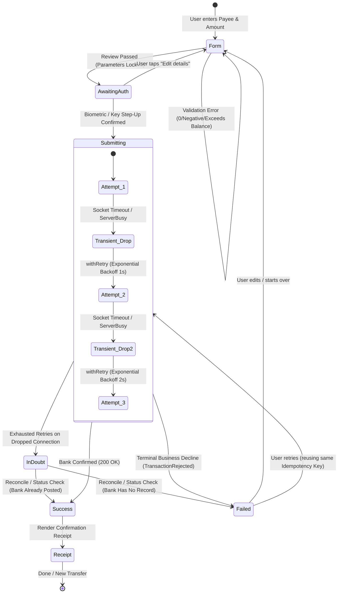

#### Key Technical Invariants & Edge Case Protections:
1. **Client-Generated Idempotency Keys:** Every transfer intent generates a cryptographically distinct reference (`idempotencyKey`) before submission. In `TransferBook`, subsequent requests with the same key compute idempotently (`computeIfAbsent`), returning the recorded amount rather than creating duplicate debit records.
2. **Mid-Flight Drop-Off Handling (`withRetry`):** If a network timeout occurs while awaiting the bank's HTTP 200 response, the engine retries up to 3 times using exponential backoff (1s, 2s, 4s) **reusing the exact same `idempotencyKey`**.
3. **In-Doubt State & Reconciliation:** If all network retries exhaust without server response, the transaction transitions to `TransferStatus.IN_DOUBT` instead of failing. The UI surfaces **"Check status"** (`viewModel.reconcile()`), querying `TransferBook.status(idempotencyKey)`. If the bank switch posted the debit prior to the network loss, it immediately confirms success without re-charging. If unrecorded, it enables safe re-attempt.
4. **Terminal Rejection Isolation:** Business declines (`TransactionRejected`, cooling period blocks, invalid VPAs) fail immediately without retry, preventing repetitive server bombardment.

### <a id="security-authentication--cryptography"></a><a id="security-authentication-cryptography"></a>Security, authentication & cryptography

- **MPIN authentication (`mpinAccepted`):** PIN authorization requires exactly four numerical digits (`pin.length == 4 && pin.all { it.isDigit() }`).
- **Cryptographic device binding:** Hardware-backed ECDSA key pairs (P-256) are generated inside the Android Keystore. During registration, the server issues a random challenge nonce that the device signs. The server verifies the public key signature and prevents nonce replay before associating the device with an account.
- **End-to-end encrypted utility bill pay (`PayBox`):** Utility bill queries and payments are protected using Elliptic Curve Diffie-Hellman (ECDH P-256) key agreement with AES-GCM (128-bit) authenticated encryption and unique 12-byte initialization vectors (IVs). Neither bill amounts nor customer identifiers travel in plaintext.
- **Background auto-lock:** The app locks the session immediately upon backgrounding, requiring OTP verification upon foregrounding.

### <a id="offline-first-synchronization--conflict-handling"></a><a id="offline-first-synchronization-conflict-handling"></a>Offline-first synchronization & conflict handling

- **Write-ahead local truth (Room Outbox):** All mutations and multi-page forms commit first to Room with a synchronization state: `SYNCED`, `PENDING_CREATE`, `PENDING_UPDATE`, or `PENDING_DELETE` on `Dispatchers.IO`. The UI observes reactive Room `Flow` streams, guaranteeing zero data loss, instantaneous UI responsiveness, and resilience across app backgrounding, memory eviction, and device restarts.
- **Resumable chunked media upload engine (`ResumableUploadManager`):** For large binary payloads (such as mortgage property inspection photos, loan documents, or receipts), uploads are partitioned into streaming chunks with byte-level progress (`bytesUploaded`, `fileSizeBytes`) persisted in Room. If network connectivity drops mid-upload (e.g., at 500 KB of 1 MB), subsequent sync attempts resume streaming directly from byte offset 500 KB rather than re-uploading from scratch.
- **Durable background sync workers (`WorkManager` + `InspectionSyncWorker`):** Background synchronization is orchestrated via WorkManager with strict `NetworkType.CONNECTED` constraints and exponential backoff retry policies. Workers iterate pending outbox items and photos, stream chunks via `ResumableUploadManager`, and update sync states upon completion.
- **Optimistic concurrency & 3-way merge conflict resolution (`mergeInspectionForms`, `ConflictInbox`, `mergeField`):** Remote 409 conflict responses preserve both local and server state models alongside the original `baseServerVersion`. Non-conflicting edits across distinct fields merge automatically; overlapping field conflicts are surfaced via `FieldMerge.Conflict(left, right)` and flagged with status `"CONFLICT"` for explicit user inspection and side-by-side resolution rather than silent data overwrites.
- **Exponential backoff retry (`withRetry`):** Network requests retry up to 3 times on transient connection drops (`IOException` or `ServerBusy`), doubling delay (1s, 2s, 4s). Terminal rejections (`TransactionRejected`) fail immediately without retry. Coroutine `CancellationException` is always propagated.


## <a id="dependencies"></a>Dependencies

Versions live in `gradle/libs.versions.toml`. A library is added only when the Android or Kotlin standard library does not already solve the problem. Why this stack instead of Retrofit, SQLDelight, Koin, and the rest is in [docs/LIBRARIES.md](docs/LIBRARIES.md).

| Dependency | Purpose |
| --- | --- |
| Kotlin, coroutines, Flow | Language, background work, and streams for Room, network, and UI state |
| kotlinx.serialization | Compile-time JSON for Retrofit DTOs and type-safe navigation routes |
| Jetpack Compose, Material 3, Compose Foundation / Animation | Screens, theme, motion, and shared components |
| Compose UI Tooling | `@Preview` / `@PreviewLightDark` in the app and library modules |
| Navigation Compose | Back stack, deep links, and typed routes; only `:app` joins feature screens |
| Lifecycle, Activity Compose, ViewModel | Configuration-change state and lifecycle-aware collection |
| Hilt, Hilt Navigation, Hilt Work | Compile-time graphs for repositories, Retrofit APIs, ViewModels, and workers |
| Room, Room Paging | Local source of truth, migrations, and paged transaction history |
| DataStore Preferences | Small settings: theme, privacy, categories, skipped update code |
| WorkManager | Durable sync work that survives process death |
| Paging 3 | Incremental transaction lists from Room into Compose |
| Retrofit (OkHttp engine) | REST, static API, device binding, and secure networking |
| OkHttp, logging interceptor | TLS, certificate pinning, HTTP cache; debug-only request summaries |
| CameraX | Lifecycle-aware camera for UPI QR capture |
| ML Kit barcode scanning | On-device QR decode from CameraX frames |
| AndroidX Biometric | System biometric prompt; keys stay in Android Keystore |
| Timber | App logging; debug tree only on debug builds |
| Chucker | On-device HTTP inspector in debug; no-op artifact in release |
| LeakCanary | Debug-only leak detection for Activities and Compose hosts |
| JUnit, AndroidX Test, Espresso, Compose UI Test | Local rules, instrumented UI, and HTTP mock tests without a server |
| Detekt, ktlint | Complexity, correctness, and formatting in CI |
| Android Gradle Plugin, Compose / serialization compiler, KSP | Variants, R8, Compose, serializers, Hilt, and Room codegen |

## <a id="tests-and-checks"></a>Tests and checks

```bash
./gradlew testMockDebugUnitTest            # app unit tests (mock flavor)
./gradlew :core:model:test :core:mock:test :core:designsystem:testDebugUnitTest
./gradlew detekt ktlintCheck lintMockDebug # static analysis
./gradlew connectedMockDebugAndroidTest    # Room, migration and sync tests (needs an emulator)
```

CI (`.github/workflows/android.yml`) runs on every push to `main` and every pull request into `main`. It runs static analysis, the app mock unit tests, the core module unit tests, and assembles the `mockDebug` APK. A failing test fails the job.

## <a id="contributing"></a>Contributing & Engineering Guidelines

All contributors and automated agents must adhere to the following architectural standards, Kotlin idioms, and financial engineering rules:

---

### 1. Architectural & Modularization Rules

- **Feature Module Isolation:** Put a new screen in its feature module (`:feature:*`). If two features need the same code, move it to a `core/` module; **never** add a dependency between features. `ModuleBoundaryTest` verifies this and fails the build on any cross-feature dependency.
- **Mock Paths for All Screens:** Every new screen should have a mock path, so the `mock` build flavor keeps running without a backend.
- **Explicit Shortcuts Documentation:** Shortcuts that are deliberately minimal are marked with a `ponytail:` comment explaining what a full version needs.

---

### 2. Financial Integrity & Currency Constraints

- **Minor-Unit Long Amounts:** Store money as a 64-bit integer (`Long`) in minor units (paise or cents), **never as a `Double` or `Float`**. Display and format it using `formatMoney`.

---

### 3. Design System & Theming Rules

- **Strict Design System Tokens:** Feature code uses theme colours (`MaterialTheme.colorScheme`, `LedgerTheme.colors`). Raw `Color(0x…)` values belong in `core/designsystem` only.
- **Multilingual String Externalization:** All user-facing UI copy (screen titles, button labels, form hints, and state messages) must be defined in `strings.xml` with complete Hindi translations in `values-hi/strings.xml`, registered in `AppStrings`, and accessed in Compose via `stringResource(AppStrings.*)`. Never hardcode user-facing strings in UI screens. Non-translatable protocol tokens (currency codes, headers) remain constant in `LedgerConstants` or `BankingHeaders`.

---

### 4. Kotlin Idioms & Coding Standards

#### A. Exception Handling & Validation
- Follow [Kotlin exception classes](https://kotlinlang.org/docs/exceptions.html#exception-classes): 
  - Use `require` / `requireNotNull` for bad arguments.
  - Use `check` / `error` for illegal state.
  - Use `getOrNull` / `firstOrNull` / `toLongOrNull` instead of catching `IndexOutOfBoundsException`, `NoSuchElementException`, or `NumberFormatException`.
  - Custom types extend `Exception` with a message and an optional cause.
  - Catch the most specific type first; **always rethrow `CancellationException`**; do not catch `Error`.

#### B. Functions & Tail Recursion
- Follow [Kotlin functions](https://kotlinlang.org/docs/functions.html#tail-recursive-functions): 
  - Use default and named arguments instead of method overloads.
  - Use a data class instead of `Pair` when the values mean different things.
  - Use a single-expression body (`fun calculate() = ...`) when the function is one expression.
  - Mark a self-call `tailrec` only when it is the last operation (not inside `try`/`catch`/`finally`, not on an `open` member) so the compiler turns it into a loop.

#### C. Lambdas & Callable References
- Follow [Kotlin lambdas](https://kotlinlang.org/docs/lambdas.html): 
  - Trailing lambda placed outside the parentheses `()`.
  - Use `it` for a single used parameter; `_` when unused.
  - Use a callable reference (`TransactionEntity::toDomain`) instead of redundant lambda wraps (`{ x -> toDomain(x) }`).
  - Keep `Unit` in a function type.
  - Use an anonymous function only when you need a local `return` or an explicit return type.

#### D. Inline Functions & Generics
- Follow [Kotlin inline functions](https://kotlinlang.org/docs/inline-functions.html): 
  - Mark a small higher-order function `inline` so the lambda is copied into the call site.
  - Use `reified` when the body needs the type (`is`/`as`, `navDeepLink<T>`).
  - Mark a lambda `noinline` if it is stored or passed on, `crossinline` if it is called from a nested object or function.
  - Do not inline a large function.
  - A public inline body may only use public or `@PublishedApi` declarations.

#### E. Class Modeling & Hierarchies
- Follow [Kotlin classes](https://kotlinlang.org/docs/classes.html): 
  - Use a `data class` for a named record (`Leg`).
  - Use an `object` when there is no instance state (`SteadyConditions`).
  - Follow [extensions](https://kotlinlang.org/docs/extensions.html) on the type they extend (`BannerTone.toneColor()`).
  - Follow [sealed classes](https://kotlinlang.org/docs/sealed-classes.html) with an exhaustive `when` (`FieldMerge`).
  - Follow [enum classes](https://kotlinlang.org/docs/enum-classes.html) for a closed set of constants (`BannerTone`, `ThemeMode`).
  - Follow [inline classes](https://kotlinlang.org/docs/inline-classes.html) only as `@JvmInline value class` wrapping one primitive or `String` when the type itself is the API — do not wrap money; keep a `Long` in minor units.
- Follow [functional interfaces](https://kotlinlang.org/docs/fun-interfaces.html): 
  - Use `fun interface` plus a SAM lambda (`AppRelease { }`, `CategoryCatalog { }`, `HomeBoard { }`, `AssistantBackend { }`) when there is one abstract member.
  - Use a function type when the API only needs a function; keep a plain interface when there are several members.

#### F. Properties & Delegated Initialization
- Follow [properties](https://kotlinlang.org/docs/properties.html): 
  - Use `val` for argument-free reads (`TransferBook.size`).
  - Use `private set` for a value the type mutates (`ChargeQueue.charges`).
  - Use `const` for compile-time primitives.
  - Use `lateinit` only for injection or test setup.
  - Follow [delegated properties](https://kotlinlang.org/docs/delegated-properties.html): `by lazy` for a one-time init (`DeviceKeys.store`); do not write a custom delegate the stdlib already covers.

#### G. Null Safety
- Follow [null safety](https://kotlinlang.org/docs/null-safety.html): 
  - Prefer safe calls and operators: `?.`, `?:`, `orEmpty()`, and `as?` instead of force-casts `!!` or `as`.
  - Use `requireNotNull` when null is a programming error.
  - Do not invent a nullable type you immediately assert.

#### H. Scope Functions
- Follow [Kotlin scope functions](https://kotlinlang.org/docs/scope-functions.html#context-object-this-or-it): 
  - `apply` (`this`, returns the object) to configure members.
  - `also` (`it`, returns the object) for a side effect that takes the object as an argument.
  - `let` (`it`, returns the lambda) for a non-null value or a local name.
  - `run` (`this`, returns the lambda) to use members and compute a result, or non-extension `run` where an expression is required.
  - `with` to group calls.
  - Prefer `takeIf` / `takeUnless` over an `if` that only filters one value.
  - Do not nest scope functions.

---

### 5. Kotlin Coroutines & Structured Concurrency

Follow the official [Kotlin coroutines guide](https://kotlinlang.org/docs/coroutines-guide.html):

- **Structured Concurrency:** Launch coroutines within well-defined lifecycle scopes (`viewModelScope`, `coroutineScope`) — **never use `GlobalScope`**.
- **Composing Suspend Functions:** Independent suspend work runs concurrently with `async`/`await` ([composing](https://kotlinlang.org/docs/composing-suspending-functions.html)); sequential when the next call needs the previous result.
- **Cancellation & Exception Propagation:** Rethrow `CancellationException` ([cancellation](https://kotlinlang.org/docs/coroutines-cancellation.html), [exceptions](https://kotlinlang.org/docs/exception-handling.html)). Never swallow cancellation exceptions in try-catch or `runCatching`.
- **Thread & Context Switching:** Switch threads with `withContext` (`Dispatchers.IO` / `Dispatchers.Default`) ([dispatchers](https://kotlinlang.org/docs/coroutine-context-and-dispatchers.html)). Repository and DAO suspend calls must be main-safe.
- **Reactive Streams:** Expose streams via [Flow](https://kotlinlang.org/docs/coroutines-flow.html) with [operators](https://kotlinlang.org/docs/coroutines-flow-operators.html) (`catch`, `sample`, `stateIn`); `delay` serves as the cancellation check in a repetitive loop.
- **Shared State & Concurrency:** Shared mutable writes across coroutines must use `Mutex.withLock` ([shared state](https://kotlinlang.org/docs/shared-mutable-state-and-concurrency.html)).
- **Channels vs Flows:** Do not add a [Channel](https://kotlinlang.org/docs/channels.html) ([channels and coroutines](https://kotlinlang.org/docs/coroutines-and-channels.html)) or experimental [select](https://kotlinlang.org/docs/select-expression.html) unless you need fan-in/fan-out pipelines or single-consumer one-off event buffers.
