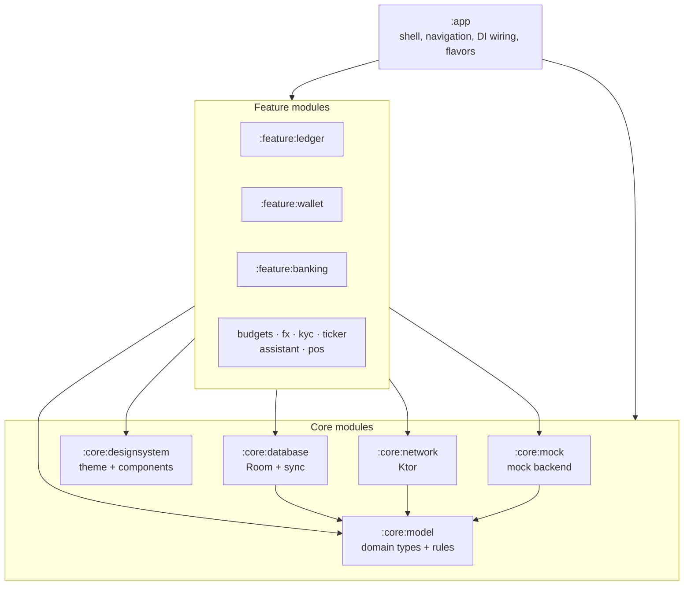
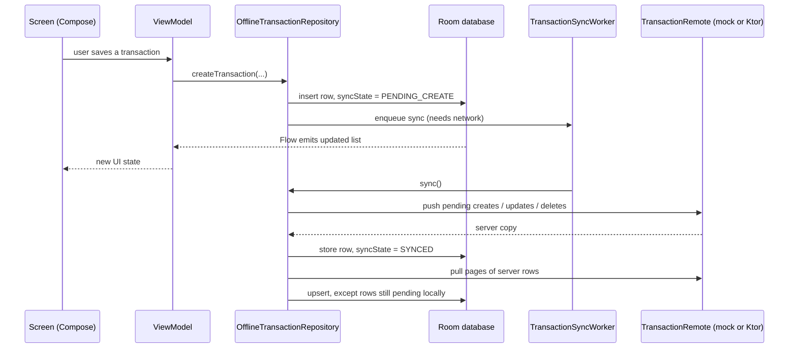

# LedgerOne architecture

This document explains how LedgerOne is put together: which module owns what, how data moves from the screen to the server and back, and the rules that keep the codebase in shape. Read it before your first change.

## The big picture

LedgerOne is a single Android app split into Gradle modules. There are three layers:

- **`:app`** is the only module that knows about everything. It owns the `Application` class, the navigation graph, and the switch between mock and live data. Shell screens live under `ui/app/` in one folder per job: `auth/`, `update/`, `hubs/`, `account/`, `scan/`, and `tools/`. The root of `ui/app/` is only the process: which shell to show, session flags, and whether the phone is online.
- **Feature modules** each own one area of the product: its screens and view models. A feature may use core modules but **never another feature**.
- **Core modules** hold shared code. `:core:model` is plain Kotlin with no Android dependency, so the business rules in it are fast to unit test.

## Module responsibilities

| Module | Owns |
|--------|------|
| `:core:model` | `Transaction`, `Money`, repository interfaces (`TransactionRepository`, `TransactionRemote`), `UserSettings`, `SyncCoordinator`, and business rules in `Rules.kt` (bill splitting, EMI, UPI payloads, idempotency, and KYC rules) |
| `:core:network` | Ktor clients and APIs, DTOs and domain mapping, `AuthInterceptor`, certificate pinning, static-response caching, Ktor WebSocket ticker, `KtorTransactionRepository` |
| `:core:database` | `LedgerDatabase` (Room, with exported schemas and migrations), DAOs, `OfflineTransactionRepository`, `TransactionSyncWorker`, `WorkManagerSyncCoordinator`, DataStore-backed settings |
| `:core:designsystem` | `LedgerOneTheme`, colours, `formatMoney` (Indian digit grouping), shared components (amount text, masked balances, PIN keypad, OTP field, banners, skeleton loaders, timelines, `FeatureScaffold`), and window security (`ui.security.SecureWindow`) |
| `:core:mock` | `MockTransactionRepository` (25 seeded INR transactions), `MockCatalog` (accounts, contacts, cards, products), `MockSwitches` (slow, failures, offline, empty, live-drop) |
| `:core:testing` | Sample objects shared by tests |
| `:feature:ledger` | Home, transaction list, detail, create and edit |
| `:feature:wallet` | Send money, UPI request, split bill |
| `:feature:banking` | Accounts, cards, loans, deposits |
| `:feature:budgets` | Budgets and charts |
| `:feature:fx` | Exchange-rate quotes and alerts |
| `:feature:kyc` | KYC case flow with saved drafts |
| `:feature:ticker` | Live market prices over a WebSocket, falling back to polling |
| `:feature:assistant` | On-device assistant that answers from the local ledger |
| `:feature:pos` | Bill payment |

## How data flows

Transactions are **offline-first**: the Room database on the phone is the source of truth, and the UI never reads from the network directly.

What this means in practice:

1. **Writes go to Room first.** Every row has a `syncState`: `SYNCED`, `PENDING_CREATE`, `PENDING_UPDATE` or `PENDING_DELETE`. Deleting a row that never reached the server just removes it.
2. **Screens observe Room through `Flow`.** The screen updates the moment you save, online or not.
3. **WorkManager pushes changes** when the network is available and retries with exponential backoff. After a successful sync it records the time, which the UI shows as "Synced".
4. **During a pull, local edits win.** A server row never overwrites a row that still has pending local changes.
5. **Conflicts** (the same transaction changed on the phone and elsewhere) go to `ConflictInbox`. The conflict screen shows each differing field side by side and saves the version you merge.

The same pattern applies to KYC drafts and assistant history, which each have their own Room table.

### Environments

The app has one flavor dimension, `environment`: `mock` (default), `dev`, `staging`, and `prod`. `RepositoryModule` uses the mock backend when `BuildConfig.FLAVOR` is `mock`, and the real API otherwise. Each flavor carries its own API host, so a debug build of prod still talks to production.

| Interface | `mock` | `dev`, `staging`, and `prod` |
|-----------|--------|------------------------------|
| `TransactionRemote` | `MockTransactionRepository` | `KtorTransactionRepository` |
| `TickerSocket` | Mock price stream (can be told to drop) | Ktor WebSocket |
| `BindingServer` | `LocalBindingServer` (verifies signatures on the phone) | `KtorBindingServer` (`devices/challenge`, `devices/bind`) |

Room, sync, view models, and screens are the same code in every flavor. Mock exercises the real offline and sync path; only the server is mock. Each flavor has its own application id, launcher name, version-name suffix, and app-link host, so the four apps install side by side.

## UI architecture

- **Compose only.** Each screen is a `@Composable` that receives state and callbacks. Screens with real logic have a Hilt `ViewModel` that exposes `StateFlow` UI state.
- **Navigation** uses type-safe routes: the `Screen` sealed interface in `:app`, built with `@Serializable` objects and classes. `LedgerNavHost` is the only place that wires routes to screens, which is how features stay unaware of each other: a feature screen takes callbacks such as `onOpen(id)`, and the app decides where they go.
- **App shell.** `LedgerOneApp` picks what to show: splash, then force-update, onboarding, MPIN login, or the main tabbed app. The app locks itself after 30 seconds in the background.
- **Design system.** Feature code takes colours from the theme and uses shared components. A hex colour in `feature/**` is a review failure.

## Security

- **MPIN and biometrics.** The MPIN is stretched with PBKDF2 (600,000 iterations) and the verifier is sealed with an Android Keystore key, so a copied preferences file cannot be guessed offline. A verifier saved by an older build is upgraded the next time it unlocks. Three wrong attempts lock the keypad for 30 seconds. Biometric unlock is optional.
- **Device binding.** During onboarding or from the Security centre, the phone creates an EC key in the Android Keystore that requires biometric authentication and is invalidated if biometrics change. The server sends a one-time challenge, the phone signs it after a fingerprint check (`SHA256withECDSA`), and the server verifies the signature before issuing a device ID. "Sign out everywhere" deletes the key.
- **Sensitive screens** (login, onboarding, send money, banking products, security) call `SecureWindow()`, which blocks screenshots and the recent-apps preview.
- **Balances are hidden** until you tap to reveal them.
- **Network.** Dev, staging, and prod use HTTPS. Debug builds also allow the emulator host and localhost. `CertificatePins` adds pinning once real pins are configured.

## Rules the build enforces

| Rule | Enforced by |
|------|-------------|
| Feature modules don't depend on each other | `ModuleBoundaryTest` |
| No raw `Color(0x…)` in feature modules | `ModuleBoundaryTest` |
| Money is a `Long` in minor units | Domain types and review |
| Room schema changes need a migration | Exported schemas + `LedgerMigrationTest` |
| Code style and size limits (140-character lines, 60-line functions, no wildcard imports) | `detekt` (`maxIssues: 0`) and `ktlint` |

## Known simplifications

These are deliberate shortcuts. Search the code for `ponytail:` to find the ones marked inline.

- Disputes are stored on this phone until a disputes endpoint exists. Sync conflicts are stored on this phone too. A live sync records one when the server answers `409` with the current transaction and then stops pushing that row; the mock flavor still creates one from Mock controls.
- Force update comes from `GET static/version`. The screen blocks the app when `versionCode` is higher than `BuildConfig.VERSION_CODE`. `GET static/status` sets `AppStatus.softUpdate` for a prompt the person can skip. A failed call does neither.
- The dev, staging, and prod device-binding endpoints are assumed. Confirm the paths and payloads with the backend team.
- The camera QR scanner runs unless the flavor is `mock`. Mock uses a sample QR so it works on emulators without a camera.
- Statements cover INR transactions only.

## Where to start

| To... | Look at |
|-------|---------|
| Add a screen to an existing feature | That feature's module, then add a route in `Screen.kt` and wire it in `LedgerNavHost.kt` |
| Add a feature area | [MODULES.md](MODULES.md): new `feature/<name>` module, include it in `settings.gradle.kts`, add it to `app/build.gradle.kts` |
| Add a core module | [MODULES.md](MODULES.md): new `core/<name>` module, include it in `settings.gradle.kts`, depend on it from `:app` or the cores that need it |
| Change a business rule | `core/model/.../core/Rules.kt` and `RulesTest` |
| Change stored data | `core/database`, bump the database version, add a migration and a migration test |
| Add demo data | `core/mock/.../MockCatalog.kt` |

Decision records live alongside this file, starting with [MADR-001](madr-001.md).
